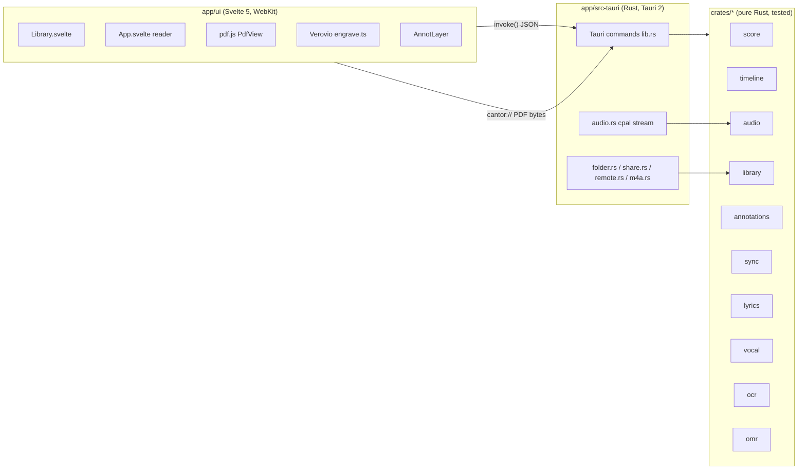

# Cantor architecture

Cantor is a score reader for choir singers and other musicians.

- It shows the original PDF, or a re-engraved MusicXML score.
- It plays every part with its own instrument, so you can rehearse your line.
- It works offline on the iPad. Mac, Android and Windows builds use the same
  code.

This document describes the code as it is (November 2026). The product
requirements are in `MusicXML Score Reader — PRD & Test-Driven Development
Plan.md`. Status and history are in `docs/IMPLEMENTATION_PLAN.md`. Phases
ahead are in `docs/ROADMAP.md`.

## Big picture



Rules that hold everywhere:

- **The original PDF is the truth.** Notation from MusicXML is an option
  beside it, never a replacement.
- **The timemap is the single source of time.** Playback, the cursor, MIDI
  export and sung lyrics all read note times from `cantor_timeline::Timemap`.
  The UI cursor follows the audio clock, never the other way round.
- **Core crates are platform-free and fully tested.** Platform glue lives
  only in `app/src-tauri` (behind `cfg(target_os)`) and in the `ocr` crate's
  Apple module.
- **Offline first.** No network calls in the client. The UI harness blocks
  all network traffic and fails if anything calls out.

## Repository layout

```
crates/                Rust workspace, core logic (no UI, no platform code)
  score/               MusicXML/MXL parse, model, transpose, edits, writer
  timeline/            repeat unfolding, tempo map, timemap, channel plan, SMF
  audio/               sample-clock scheduler, SoundFont synth, mixer, backing tracks
  library/             library.json store, import, bundles, backup, forScore
  annotations/         annotation model (ANN-01..05), PDF export
  sync/                folder sync: per-device op logs, merge rules
  lyrics/              lyric extraction to sung phrases
  vocal/               singing engine adapters (SoulX-Singer serialiser)
  ocr/                 Apple Vision text recognition, title-page reader
  omr/                 PDF -> MusicXML via Audiveris (desktop CLI), measure maps
app/
  src-tauri/           Tauri 2 backend: commands, audio stream, iOS glue
    gen/apple/         Xcode project (xcodegen: project.yml)
    resources/scores/  bundled demo scores (git-ignored, private)
  ui/                  Svelte 5 + TypeScript UI, pdf.js, Verovio (WASM)
assets/sf2/            GeneralUser GS SoundFont and its licence
fixtures/              public test inputs (MusicXML, audio, OCR page)
tools/                 CI and dev scripts (trace, coverage, licences, UI harness, OMR, SoulX)
docs/                  plan, roadmap, decisions, spikes, formats
```

## Core crates

| Crate | Responsibility | Key types | Depends on |
|---|---|---|---|
| `score` | Parse MusicXML and MXL into a model with fixed ticks (`PPQ`); transpose; note edits; write MusicXML back | `Score`, `Part`, `Measure`, `Event` (notes, rests), `Pitch`, `NoteEdit` | quick-xml, zip |
| `timeline` | Unfold repeats, voltas, D.C./D.S./Coda/Fine; tempo map; timemap; plan mixer channels per sung line (voices, roles, instruments); write SMF | `Timemap`, `ChannelPlan`, `Choir` | score, midly |
| `audio` | Sample-accurate scheduler; mixer (volume, pan, mute, solo, presets); SoundFont synth (rustysynth); backing tracks; offline render | `Engine<S: Synth>`, `SoundFontSynth`, `Preset` | score, timeline, rustysynth, symphonia |
| `library` | `library.json` store (metadata, setlists, settings, manual order, presets); import from Files; `.cantorset` bundles; `.cantorbackup`; forScore `.4sc/.4ss` import and export | `Store`, `Metadata`, `Setlist`, `ScoreSettings` | serde, zip, plist, sha2 |
| `annotations` | Annotation model anchored to PDF pages or to bars (survives re-layout); undo; layers; annotated PDF export | `Document`, `Layer`, `Item`, `Anchor` | lopdf, png |
| `sync` | Sync through any folder (iCloud Drive, OneDrive, USB): one append-only op log per device, content-addressed blobs, last-writer-wins and observed-remove merge | `SyncFolder`, ops | annotations, sha2 |
| `lyrics` | Extract phrases (syllables, melismas) per part and verse, timed by the timemap | `Phrase`, `SungNote` | score, timeline |
| `vocal` | Engine-neutral singing requests; SoulX-Singer serialiser; English G2P | `soulx::RenderSettings` | lyrics |
| `ocr` | Apple Vision text recognition (Swedish + English) on Apple platforms; title-page reader (title, composer, arranger, lyricist, choir type) everywhere | `recognize`, `guess_metadata`, `TitlePage` | objc2-vision (Apple only) |
| `omr` | Desktop CLI `cantor-omr`: PDF/.4sc/.4ss -> Audiveris -> MusicXML -> MIDI; scan cleanup; measure maps so the cursor works on the PDF | `OmrEngine`, `measure_map` | score, timeline, library |

Each crate's `lib.rs` starts with a module doc that explains its model in
more detail. Tests sit in `crates/*/tests/`, named after the PRD requirement
they prove (`lib_03_…`, `play_02_…`).

## The app

### Backend (`app/src-tauri`)

- **`lib.rs`** holds the Tauri commands the UI calls with `invoke()`.
  - Library: `list_scores`, `library_data`, `set_metadata`, `search_scores`,
    `save_setlist`, `set_order`, `import_bytes`, `delete_score`.
  - Reader: `open_score` (MusicXML for engraving, mixer channels, measure
    times, PDF URL and measure map), `play`, `pause`, `seek`, `set_tempo`,
    `set_loop`, `set_click`, `status`, `set_channel`, `apply_preset`,
    `pitch_pipe`.
  - Practice and export: `export_audio` (WAV/M4A), `export_item` (annotated
    PDF, `.4sc`, `.cantorset`, `.4ss`), `attach_track` and the other
    backing-track commands.
  - Data: `annotations_open` / `annotations_edit`, `backup_library` /
    `restore_library`, `sync_now` / `choose_sync_folder`.
  - Recognition: `correct_note` (fix a misread note), `read_title_page`
    (on-device text recognition).
  - Diagnostics: `perf_mark`.
- **The `cantor://` URI scheme** serves library PDFs to pdf.js
  (`cantor://localhost/<dir>%2F<file>.pdf`; `http://cantor.localhost/` off
  Apple).
- **`audio.rs`** opens the cpal output stream and drives
  `cantor_audio::Engine` from the audio callback. On iOS the audio session is
  set to Playback, so sound plays with the silent switch on and in the
  background.
- **iOS glue** (`objc2`), all behind `cfg(target_os = "ios")`:
  - `folder.rs`: folder picker and security-scoped bookmark for sync.
  - `share.rs`: share sheet.
  - `remote.rs`: lock-screen and remote commands.
  - `m4a.rs`: AAC export through AudioToolbox.
- **Score ids** are `"<dir>:<stem>"`. Dir `0` is the bundled demo scores
  (read-only) and dir `1` is the user's Documents folder. A score is all files
  with the same stem:
  - `.mxl` / `.musicxml`
  - `.pdf`
  - `.measures.json` (measure map)
  - `.track.<ext>` and `.track.json` (backing track)

### UI (`app/ui`)

- **Svelte 5 (runes) and TypeScript**, built with Vite. Tauri serves it from
  `ui/dist`.
- **`App.svelte`** is the reader: PDF or notation view, transport, mixer,
  annotation layer, page modes, follow mode, pitch pipe.
- **`lib/Library.svelte`** is the library grid, search, setlists and
  drag-to-rearrange (`reorder.ts`: compositor-only transforms; one DOM
  reorder on drop).
- **Rendering:**
  - `lib/pdf.ts` / `PdfView.svelte` / `PdfPage.svelte`: pdf.js, including
    WASM decoders for JBIG2 scans.
  - `lib/engrave.ts`: Verovio (WASM) engraving, with note ids for corrections
    and anchors.
- **Shared UI services:**
  - `lib/i18n.svelte.ts`: Swedish and English strings.
  - `lib/prompts.svelte.ts` / `Dialog.svelte`: in-app dialogs (WKWebView
    shows no `prompt()`).
  - `skins.ts` and `app.css`: light, dark and sepia themes. Accessibility
    target is WCAG 2.2 AA.

### Data on disk (per device)

| Where | What |
|---|---|
| `Documents/` | The user's scores (`<stem>.*` files) |
| `Documents/library.json` | Metadata, setlists, per-score settings, manual order. Atomic saves (`.tmp`, then rename); a corrupt file is kept as `.bak` |
| `Documents/Annotations/<score id>.json` | Annotations per score (id with unsafe characters replaced by `_`) |
| `Documents/.sync/` | Device id, folder bookmark, sync state |
| `Documents/Inbox`, `.incoming` | Files arriving through the share sheet or Open in |
| `Documents/.perf.log` | Timings from `perf_mark` and text recognition (not backed up) |
| `Documents/Export`, `Backups` | Generated files |

## Main flows

**Opening a score.**

1. The UI calls `open_score(file)`.
2. The backend parses MusicXML (`score`), unfolds it into a timemap
   (`timeline`), plans channels (voices to instruments), loads the engine,
   and returns the MusicXML, channels, measure times, PDF URL and measure map.
3. The UI renders the PDF with pdf.js, or the notation with Verovio, and polls
   `status` for the playing position.
4. The cursor box comes from the measure map on the PDF, or from Verovio's
   element ids in notation.

**Playback.** The scheduler sends note events on their exact sample frame.
Mixer changes are sent as controllers, so they affect sounding notes.
Presets (My part / Without me / Balance) are mixer states.

**PDF-only scores** (forScore imports, scans):

- They read and annotate like any PDF.
- They get notes through `cantor-omr` on a desktop: Audiveris, then MusicXML
  plus a measure map next to the PDF.
- On-device note recognition was measured but is not shipped
  (`docs/omr-engine-comparison.md`).

**Sync.** Each device appends operations to its own log file in the chosen
folder and reads the other devices' logs. Merge rules:

- Last writer wins per key for library entries.
- Observed-remove sets for annotations.

The result does not depend on order (tests `data_02_*`).

**Text recognition.**

1. pdf.js renders page 1 to a PNG.
2. `read_title_page` runs Apple Vision on it off the main thread.
3. `guess_metadata` fills in empty fields.

## Testing and quality gates

Each gate runs in CI (`.github/workflows/core.yml`, self-hosted macOS runner).

| Gate | Command |
|---|---|
| Format, lints | `cargo fmt --all --check`, `cargo clippy --workspace --all-targets -- -D warnings` (same in `app/src-tauri`) |
| Unit and requirement tests | `cargo test --workspace`; `cd app/src-tauri && cargo test --lib` |
| Requirement traceability | `tools/trace.sh` lists tests per requirement; 3 P0s have none (parked singing). `--strict` fails on gaps |
| Coverage ≥ 85% per core crate | `tools/coverage.sh` |
| Dependency licences | `tools/licenses.py` (allow-list; `THIRD_PARTY_NOTICES.md` must be current) |
| UI scenarios + accessibility | `tools/ui_harness/run.sh all`: Playwright WebKit at iPad mini size, backend mocked in `mock.js`, network blocked, axe WCAG 2.2 AA on 12 screens × 3 skins × 2 languages, frame timing for drag and drop |

The UI harness uses a private sample score when it is available. Public
fixtures live in `fixtures/`.

## Platform notes

- **iOS / iPadOS** (the main target):
  - Tauri 2 iOS, built with `cargo tauri ios build`.
  - The Xcode project comes from `gen/apple/project.yml` (run `xcodegen
    generate` after edits).
  - System frameworks are listed there: AudioToolbox, MediaPlayer, Vision,
    and others. Frameworks named only by Rust crates inside the static
    `libapp.a` are not linked automatically.
- **macOS:** the same code; `cargo test` runs the Apple Vision test on the
  Mac.
- **Android and Windows:** planned, not built. Platform-specific code is
  behind `cfg`, and non-Apple builds get `OcrError::Unsupported` for text
  recognition.

## Licences

- **Cantor:** AGPL-3.0-only, with an app store permission under section 7
  (`LICENSE`, `LICENSE-EXCEPTIONS.md`).
- **Contributions:** need the CLA (`CONTRIBUTING.md`).
- **Third-party components:** listed in `THIRD_PARTY_NOTICES.md` and checked
  in CI.
- **homr** (AGPL, no app store permission) must not be linked into the
  client. See `docs/monetization-feasibility.md`.
