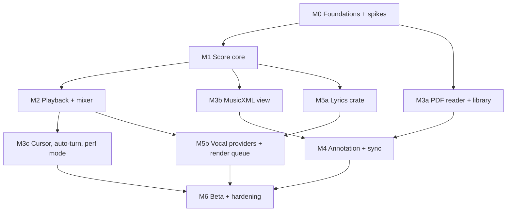

# Cantor: Implementation Plan

Derived from `MusicXML Score Reader - PRD & Test-Driven Development Plan.md` (2026-11-21).
This turns the PRD milestones into ordered, test-first work packages with explicit
dependencies, test names and exit gates. Requirement IDs (LIB-01, PLAY-02, ...) are the
PRD's; work package IDs (WP-x.y) are new.

## 0. Guiding decisions

| Topic | Decision | Reason |
| --- | --- | --- |
| Core language | Rust workspace, edition 2021, MSRV pinned in `rust-toolchain.toml` | PRD section 6 |
| Single source of time | `timeline::Timemap` (unfolded, tempo-resolved) is consumed by audio, cursor, lyrics, vocal | PRD: "the unfolded timemap is the one source of time" |
| Internal time units | Musical time = rational `divisions` ticks normalised to a fixed PPQ (960 per quarter). Real time = `u64` sample frames at the engine rate, seconds only at the edges | Avoids float drift (< 5 ms after 10 min target) |
| Determinism | Every engine (synth, mixer, scheduler) supports offline render to a buffer | Enables audio tests (~8% of suite) without devices |
| Test naming | `<reqid>_<behaviour>`, e.g. `play_02_dal_segno_al_coda_unfolds_in_order` | PRD TDD rule 2 |
| Snapshots | `insta` with JSON (`*.timemap.json`, `*.events.json`, `*.lyrics.json`) | PRD fixtures section |
| Oracle | Verovio CLI/Python run in `tools/oracle` produces expected outputs once, checked in; CI never needs Verovio to run unit tests | Keeps core CI hermetic |
| Errors | `thiserror` per crate, no panics on bad input; fuzz the parser (`cargo fuzz`) | LIB-01 "never a crash" |

## 1. Dependency graph



Critical path: M0 -> M1 (parser, unfolding, timemap) -> M2 (scheduler, mixer) -> M3c -> M6.
M3a (PDF, library, forScore import) and M5a (lyrics) are off the critical path and can run in parallel
with a second developer from week 3 to 5.

## 2. Crate responsibilities and public API sketch

```
crates/score     Score, Part, Staff, Voice, Measure, Event{Note,Rest,Chord}, Pitch, Lyric,
                 Direction{Tempo,Dynamic,Segno,Coda,Fine,DaCapo,...}, Barline{Repeat,Ending}
                 parse_musicxml(&[u8]) -> Result<Score>, parse_mxl(&[u8]) -> Result<Score>
                 transpose(&Score, semitones) -> Score
crates/timeline  unfold(&Score) -> Vec<MeasureVisit>; TempoMap; Timemap { events: Vec<TimedEvent> }
                 TimedEvent { part, staff, voice, measure_visit, tick_on, tick_off, sec_on, sec_off, pitch, velocity }
crates/audio     Channel{gain_db,pan,mute,solo}; Mixer; resolve_audibility(&[Channel]) -> Vec<bool>;
                 Preset{MyPart,WithoutMe,Balanced,Custom}; Scheduler (sample clock); Synth trait
                 (rustysynth impl); render_offline(&Timemap, &Mixer, sr) -> Vec<f32>; Loop{a,b}; Metronome
crates/lyrics    extract(&Score, part, verse) -> Vec<Phrase>; Phrase{syllables: Vec<Syllable{text, notes, syllabic}>}
crates/vocal     trait VocalProvider { estimate, render(phrase), voices }; adapters; RenderCache (content hash)
crates/library   SQLite schema, metadata, search (FTS5), setlists, backup/restore, forScore import (.4SC/.4SS/.4SB)
app/             Tauri 2 + Svelte; Verovio WASM view; PDF.js / PDFKit plugin; keyring plugin
```

## 3. Milestones as work packages

Each WP lists: tests written first (red), then the build, then done criteria.

### M0 Foundations + spikes (weeks 0 to 3)

| WP | Tests first | Build | Done |
| --- | --- | --- | --- |
| WP-0.1 Workspace | `cargo test` on empty workspace; smoke test per crate | Cargo workspace with 6 crates, `rust-toolchain.toml`, `clippy`/`fmt` config | `cargo test --workspace` green locally |
| WP-0.2 CI | CI job fails if any test fails, if fmt/clippy fail, or coverage < threshold | GitHub Actions: Linux, macOS, Windows core; iOS sim + Android emulator jobs stubbed until app exists | All 5 target jobs exist; core jobs green |
| WP-0.3 Corpus | `fixtures_manifest_lists_existing_files` (every manifest entry exists, has expected outputs) | Collect 40 files: MusicXML unofficial test suite subset (repeats, voltas, tuplets, lyrics, transposing), 10 CPDL SATB, 1 stress score. `fixtures/manifest.toml` with licence per file | 40 files + licences recorded |
| WP-0.4 Oracle | Oracle script is deterministic (run twice, identical output) | `tools/oracle`: Verovio (Python bindings) -> `*.timemap.json`, `*.events.json` (from Verovio MIDI) normalised to our schema | Expected outputs checked in |
| WP-0.5 First red test | `lib_01_parses_hello_world_musicxml` | Minimal parser for that file | Green |
| S1 Verovio WASM in Tauri on iPad | Measure first-page time on a 20-page score | Throwaway Tauri iOS app | Report: first page time, memory, LGPL plan |
| S2 Singing quality | Pitch/onset metric script (pYIN) on 3 English + 3 Swedish pieces | Scripts in `tools/spikes/s2` | **Engine chosen by ear (2026-11-22, `docs/spikes/singing-engines.md`): SoulX-Singer, 16 steps, no CFG (RTF 2.5 on M2 GPU).** Sung lyrics are English only (decision 2026-11-22) |
| S3 ElevenLabs STS on sung guide | Same metric before and after STS | Script | Report: cents error delta; keep or drop hybrid |
| S4 Pencil ink latency in WebView | High-speed video or `PointerEvent` timestamps vs display | Throwaway app | Report answers Q6 (native overlay needed?) |
| S5 forScore formats | Parse each example file without unknown-byte loss (round-trip of container) | Format notes `docs/formats/forscore.md`, prototype parser in `crates/library` | Documented structure of .4SC/.4SS/.4SB |

Blocking inputs from product owner: forScore example files (S5), decisions Q3, Q5, Q6.

### M1 Score core (weeks 3 to 7)

| WP | Tests first | Build | Done |
| --- | --- | --- | --- |
| WP-1.1 Partwise parser | `lib_01_parses_hello_world_musicxml`, `lib_01_parses_every_corpus_file`, `lib_01_invalid_xml_returns_error_not_panic`, fuzz target `parse_musicxml` | quick-xml streaming parser for `score-partwise`: part-list, attributes (divisions, key, time, clef, transpose, staves), note (pitch, unpitched, rest, duration, voice, staff, chord, grace, tie, time-modification, lyric), backup/forward, direction, sound, barline | >= 98% corpus parses |
| WP-1.2 Timewise + MXL | `lib_01_parses_mxl_container`, `lib_01_timewise_equals_partwise_model` | zip + `META-INF/container.xml` rootfile lookup; timewise -> partwise conversion | Green |
| WP-1.3 Model normalisation | `score_divisions_normalised_to_960_ppq` (proptest: any divisions value), `score_backup_forward_assign_voice_offsets` | Normalise ticks, resolve chords, voices per staff (needed for PLAY-05) | Green |
| WP-1.4 Transpose | `view_05_transpose_roundtrip_property` (proptest, n in -24..24), `view_05_transposing_instrument_concert_pitch` | Pitch spelling via line-of-fifths, key signature transpose, `<transpose>` handling | Green |
| WP-1.5 Unfolding | `play_02_simple_repeat`, `play_02_voltas_1_2`, `play_02_da_capo_al_fine`, `play_02_dal_segno_al_coda_unfolds_in_order`, `play_02_nested_and_times_attribute`, property: unfolded duration = sum of visited measure durations | Repeat stack state machine, endings by `number` list, jump directions from `<sound dacapo/dalsegno/tocoda/fine>` and words fallback | 100% navigation fixtures match oracle |
| WP-1.6 Tempo map + timemap | `play_01_timemap_matches_oracle` per fixture (insta), `play_02_tempo_change_mid_measure`, `play_02_meter_change`, `play_02_tuplets_exact_ticks`, `play_02_ties_merge_notes`, `play_02_grace_notes_steal_time`, drift test: 10 min at 7/8 + tempo changes accumulates < 1 sample error | `TempoMap` (tick -> seconds, piecewise), `Timemap` builder, tie merging, grace policy | Gate M1 |

Gate M1: >= 98% corpus parses; timemaps equal oracle on 100% of navigation fixtures; >= 85% line coverage (cargo-llvm-cov) on `score` and `timeline`.

### M2 Playback + mixer (weeks 7 to 11)

| WP | Tests first | Build | Done |
| --- | --- | --- | --- |
| WP-2.1 Event list | `play_01_events_equal_reference_midi` (pitch, onset, duration per fixture) | Timemap -> `MidiEvent` stream per channel | Green on corpus |
| WP-2.2 Channels | `play_05_two_voices_one_staff_are_two_channels`, `play_09_midi_program_respected`, `play_09_soprano_falls_back_to_choir_aahs` | Channel graph keyed by (part, staff, voice); GM program mapping + name heuristics table | Green |
| WP-2.3 Mute/solo/gain | `play_03_solo_mute_truth_table` (table-driven, all 2^n for n<=4 + proptest), `play_03_gain_range_minus_inf_to_plus6`, `play_04_my_part_sets_exact_gains`, `play_04_without_me_mutes_selected`, `play_04_balanced`, `play_04_custom_preset_persists` | Pure mixer maths in `audio::mix`, presets serialisable (serde) | Green |
| WP-2.4 Synth + offline render | `audio_offline_render_is_deterministic`, `play_03_solo_correlation_gt_099` (property), `audio_no_clipping_at_64_parts` | `Synth` trait, rustysynth impl with MuseScore General SF2 (downloaded in CI, not committed if size is an issue), limiter | Green |
| WP-2.5 Scheduler | `play_06_tempo_change_applies_next_beat`, `play_07_loop_wraps_within_one_buffer`, `play_06_count_in_bars`, `perf_03_metronome_jitter_lt_1ms` (offline) | Sample-clock scheduler, lookahead queue, tempo scaling via timemap re-resolution, A-B loop by measure-visit range | Green |
| WP-2.6 Realtime output | Device test: buffer size <= 10 ms on Mac (`cpal`), xrun counter = 0 over 60 s at 64 parts | cpal backend, lock-free command queue (rtrb) from UI to audio thread, position feedback ring for cursor (NFR-02) | NFR-01 met on Mac; iPad measured in M3 |

Gate M2: all PLAY P0 green; NFR-01 latency met on iPad and Mac.

### M3 Reader UI (weeks 9 to 16)

Split in three tracks.

**M3a Library + PDF (from week 9, independent of playback)**

| WP | Tests first | Build |
| --- | --- | --- |
| WP-3.1 Library DB | `lib_03_metadata_survives_restart`, `lib_03_export_import_roundtrip`, `lib_04_search_10k_lt_100ms` (bench), `data_03_restore_identical_hash` | SQLite (rusqlite) schema + migrations, FTS5 over metadata and part names |
| WP-3.2 PDF import/view | `lib_02_500_page_import_lt_3s`, thumbnails lazy (Playwright) | PDF.js in web/desktop, PDFKit plugin on Apple |
| WP-3.3 forScore import | `lib_07_every_example_imports`, `lib_07_annotation_positions_within_2pt`, `lib_07_unknown_fields_preserved`, `lib_08_setlist_order_and_placeholders`, `lib_08_backup_score_count` | Parsers from S5 |
| WP-3.4 Setlists | `set_01_reorder`, `set_01_placeholder_in_performance_mode` | Setlist model + UI |

**M3o OMR: notes from PDFs (promoted from v2, decision 2026-11-21)**

forScore files and PDFs carry no note data, so playback, mixer and sung parts
for a forScore library need optical music recognition. LIB-06 moves from P2 to
P0 for v1. Pipeline: PDF -> Audiveris -> MusicXML -> timemap -> MIDI/audio.
The user corrects recognition errors later (WP-3.13).

| WP | Tests first | Build |
| --- | --- | --- |
| WP-3.11 Pipeline | `lib_06_pdf_to_musicxml_and_midi`, `lib_06_4sc_embedded_pdf_is_recognised`, `lib_06_engine_failure_is_reported_not_panicked` | `crates/omr`: `OmrEngine` trait, Audiveris CLI adapter, `cantor-omr` tool (done) |
| WP-3.12 Scan cleanup | `lib_06_retries_with_cleaned_scan_when_raw_pdf_fails`, `lib_06_empty_result_triggers_cleanup` | 300 DPI render, crop, deblur, threshold, despeckle (Python today in `tools/omr`, port to Rust) |
| WP-3.13 Correction UI | `lib_06_user_edit_survives_reopen`, `lib_06_low_confidence_measures_flagged` | Measure-level review: overlay recognised notes on the PDF, flag measures whose length does not match the time signature, edit pitch/duration |
| WP-3.14 Where OMR runs | `lib_06_remote_engine_contract` (mock server) | Desktop: Audiveris sidecar (85 MB download, ships its own Java runtime). iPad/phone: remote OMR server the user runs (same model as HF voice), or OMR on the desktop app and sync |
| WP-3.15 Measure map | `lib_05_cursor_on_pdf_from_omr_measure_map` | Keep Audiveris staff/measure boxes (`.omr` book) so the play cursor and auto-turn work on the original PDF (LIB-05) |

Measured on the product owner's 12 scanned choral scores (spike S6):

| Result | Scores |
| --- | --- |
| Recognised from the raw PDF | 9 of 12 |
| Recognised after scan cleanup (WP-3.12) | +1 (kunglilje: 665 notes) |
| Recognised page by page (book crashed on a page without music) | +2: Glimmande Nymf (page 3 is verse text), I bröllopsgården (page 1 is a blank/cover scan) |
| Still failing | Supa klockan öfver tolf (old engraving with faint staff lines, 6 notes found, reported as failed instead of a near-empty MIDI) |
| Same notes and onsets as MuseScore's playback of the same MusicXML | Olaf Trygvason 100%, Stad i ljus 100%, Jag och min far 98%, Bacchi 95%, Calypso 92%, Är jag född 91% |
| Island | 99% after repeat unfolding (was 19%) |
| Glimmande Nymf | 100% |
| I bröllopsgården | 36%: the scan has many meter changes (7/8, 5/4, 15/16) that OMR misses, so measure lengths differ from MuseScore's reading; needs the correction UI (WP-3.13) |
| Do you hear what I hear (TTBB, added 2026-11-22) | 18 PDF pages that are iPad screenshots of two-page publisher "PREVIEW" spreads at about 100 DPI, each spread captured twice. Raw: only 2 pages read (40 tenor notes). With `tools/omr/split_spreads.py` (crop screen border, split at the gutter, upscale, background division removes the grey watermark, drop duplicate pages): 141 measures, 4 voices with 240-259 notes each, piano 1797 notes, 332 s. Pitch accuracy not checked against a reference. Lyrics OCR is poor at this resolution: words run together ("doyouseewhat"), about 20 unknown words per voice, sung on "la". Not yet wired into the automatic fallback ladder |

OCR for lyrics and text: Audiveris needs Tesseract `tessdata` (full, not
`tessdata_fast`, it uses the legacy engine). With `swe+eng`, Å/Ä/Ö are read
correctly ("Är jag född"); with English only they become A/a/o.

Full run with `swe+eng` OCR (2026-11-22): 11 of 12 convert, 9 MusicXML files
carry lyrics (30 to 684 syllables each; the two joined page-by-page files have
none yet because the writer does not model lyrics). Against MuseScore: Calypso,
Olaf, Stad i ljus, Är jag född, Glimmande Nymf 100%, Island 99.8%, Bacchi 97%.
Side effects of OCR to handle:
- Misread text becomes chord symbols (`<harmony>`, 37 in "Jag och min far");
  MuseScore plays them, Cantor rightly does not. Strip or ignore them on import.
- Part names become OCR noise (". '1'", "Tent or"): name parts from staff
  position/clef (S/A/T/B) and let the user rename.
- Text recognition changes how Audiveris splits systems into parts (kunglilje
  2 -> 4 parts); the per-part mixer needs a "merge parts" action.

That measures **our MIDI generation** against an independent player. It does
not measure **OMR accuracy** against the printed page; that needs hand-checked
ground truth for a few pieces (WP-3.13 fixtures).

**M3b MusicXML view (after M1)**

| WP | Tests first | Build |
| --- | --- | --- |
| WP-3.5 Engraving | `view_01_golden_png_matches` (pixelmatch tolerance), `view_03_phone_width_ge_2_measures_per_system` | Verovio WASM worker, SVG per page, off UI thread (NFR-03) |
| WP-3.6 Page modes | `view_02_each_mode_one_tap`, `view_02_position_kept_on_rotation` | Single, two-up, half-page, scroll |
| WP-3.7 Part visibility/themes | `view_04_hidden_part_still_plays`, `view_06_contrast_ge_4_5` | Verovio part filter, CSS themes |

**M3c Performance (after M2)**

| WP | Tests first | Build |
| --- | --- | --- |
| WP-3.8 Cursor + auto-turn | `play_08_cursor_highlights_sounding_note`, `play_08_turns_before_last_system_ends` | Verovio `getElementsAtTime`, cursor driven by audio clock ring |
| WP-3.9 Perf mode + pedals | `perf_01_no_annotation_in_performance_mode`, `perf_02_pedal_maps_to_action` (HID simulation) | Lock overlay, key mapping settings |
| WP-3.10 E2E flow | Playwright: import -> open -> turn page -> play -> solo alto | Wiring |

Gate M3: LIB, VIEW, SET, PERF P0 green; 20-page PDF opens in < 1 s on iPad.

### M4 Annotation + sync (weeks 16 to 20)

| WP | Tests first | Build |
| --- | --- | --- |
| WP-4.1 Ink model | `ann_01_undo_100_steps`, `ann_02_layer_visibility_persists`, `ann_03_stamps_scale_with_zoom` | Stroke model (Automerge doc per score), layers, stamps, text |
| WP-4.2 Anchoring | `ann_04_annotation_stays_on_measure_after_reflow` (fixture at 3 widths) | Anchor = (measure id, staff, offset in measure-normalised coords) |
| WP-4.3 Ink latency | Device test `ann_01_ink_latency_lt_20ms` | WebView canvas or native overlay per S4 |
| WP-4.4 Sync + backup | `data_02_two_devices_converge` (CRDT merge property), `data_03_restore_identical_hash`, `data_01_p0_offline` | Folder sync of Automerge changes + SQLite export; backup bundle |
| WP-4.5 Annotated PDF export | `ann_05_annotations_in_exported_pdf` (parse output with lopdf) | PDF writer |

### M5 Sung lyrics (weeks 16 to 25)

**M5a Lyrics (can start after WP-1.6, week 7, with a spare developer)**

| WP | Tests first | Build |
| --- | --- | --- |
| WP-5.1 Extractor | `vox_01_lyric_fixtures_expected_phrases` (insta), property: no syllable on a rest, every `begin` closed by `end`, melisma spans notes until next syllable/extender end | `crates/lyrics` |
| WP-5.2 Timing resolver | `vox_tempo_and_transpose_applied_from_timemap` | Phrase splitting at rests >= 1 beat or breath marks, seconds from timemap |

**M5b Vocal**

| WP | Tests first | Build |
| --- | --- | --- |
| WP-5.3 Provider trait + mock | `vox_03_rendered_track_becomes_mixer_channel`, `vox_06_estimate_requires_confirmation`, `nfr_12_cap_10_minutes` | `VocalProvider` trait, render queue, `MockProvider` |
| WP-5.4 Cache | `vox_07_reopen_uses_cache_no_api_call`, `vox_08_mute_does_not_rerender`, `vox_08_tempo_rerenders_affected_phrases` | Content hash of (phrase, tempo, transpose, voice, provider), files on disk |
| WP-5.5 Keys | `vox_02_key_never_in_logs` (log capture), `vox_02_key_deletable`, `vox_02_validated_with_test_call` (mock) | Keyring plugin, redacting `Secret<String>` type |
| WP-5.6 Adapters | **SoulX-Singer first** (serialiser done in `cantor-vocal::soulx`; runner: Core ML conversion on Mac/iPad, server for phones). DiffSinger (ONNX, with variance model) as fallback if a re-test sounds acceptable; ElevenLabs Music optional. Contract tests per adapter | Core ML / PyTorch runner, HTTP adapters (reqwest) for server engines |
| WP-5.6b Voices | `vox_09_prompt_voice_licence_shown`, `vox_09_consent_required_for_reference_clip` | Ship 3 to 5 prepared SoulX voice prompts recorded under our own licence (S, A, T, B); Core ML conversion at fp16, int8 test for phones |
| WP-5.7 Accuracy nightly | `vox_04_median_pitch_error_lt_50_cents`, onset within one sixteenth | pYIN/CREPE script against live endpoints |
| WP-5.8 Voice choice | `vox_09_consent_required_for_reference_clip`, clip sent only to chosen provider | Settings UI |

### M6 Beta + hardening (weeks 25 to 30)

Accessibility tests (axe in Playwright, VoiceOver labels), `nfr_10_sv_en_localisation_complete`,
2-hour soak `nfr_02_no_drift_gt_5ms`, licence page from `fixtures`/asset manifest (NFR-09),
TestFlight, Play beta, Windows installer.

### P1, P2 and NFRs not covered by a WP above

| Req | Slot | Test first |
| --- | --- | --- |
| LIB-05 (P1) Link PDF + MusicXML | M3c, after WP-3.8 | `lib_05_cursor_on_pdf_with_manual_measure_map` |
| LIB-06 OMR via Audiveris | **P0 for v1** (was P2), see M3o | `lib_06_*` (8 tests) |
| LIB-09 (P2) Export .4SC/.4SS | v2, reuses S5 parser | `lib_09_roundtrip_keeps_annotations` |
| PLAY-10 (P1) Dynamics/articulations | M2, with WP-2.1 | `play_10_pp_lt_mf_lt_ff_velocity`, `play_10_staccato_halves_length` |
| PLAY-11 (P1) Export WAV/M4A | M2, after WP-2.4 (reuses offline render) | `play_11_export_length_within_10ms` |
| PLAY-12 (P1) Background audio, media keys | M3c | Device tests on iOS/Android (lock screen) |
| VOX-05 (P1) ElevenLabs performance mode | M5b, WP-5.6 | `vox_05_labelled_not_score_accurate`, `vox_05_aligned_by_word_timestamps` |
| SET-02 (P1) Setlist bundle | M4, with WP-4.4 | `set_02_bundle_identical_content_hash` |
| PERF-04 (P1) Backing tracks + turn markers | M3c | `perf_04_turn_markers_within_50ms` |
| NFR-04 Memory <= 400 MB | M6 | Device memory probe with 50 MB SF2 + 100-page score |
| NFR-05 Offline | Same as DATA-01 (WP-4.4) | `data_01_p0_offline` |
| NFR-06 Secrets | WP-5.5 | `vox_02_key_never_in_logs`, plus `nfr_06_backup_contains_no_keys` |
| NFR-07 Privacy | M6 | `nfr_07_no_network_without_opt_in` (network capture in E2E) |
| NFR-08 Accessibility | M6 (axe), labels checked from M3 | `nfr_08_all_controls_labelled` |

## 4. Staffing and calendar (2 to 3 developers)

| Weeks | Dev A (core) | Dev B (app) | Dev C (optional, voice) |
| --- | --- | --- | --- |
| 0 to 3 | WP-0.1 to 0.5 | S1, S4 | S2, S3, S5 |
| 3 to 7 | M1 | WP-3.1, 3.3 (forScore import) | WP-5.1 (lyrics) after WP-1.3 |
| 7 to 11 | M2 | WP-3.2, 3.4, 3.5 | WP-5.2, 5.3 |
| 11 to 16 | WP-2.6 iPad, help M3c | M3b, M3c | WP-5.4, 5.5 |
| 16 to 20 | M4 sync/backup core | M4 ink UI | WP-5.6 |
| 20 to 25 | Perf + bugs | Polish | WP-5.7, 5.8 |
| 25 to 30 | M6 | M6 | M6 |

## 5. Traceability

`docs/traceability.md` (generated) maps each requirement ID to its tests. A CI script
(`tools/trace.sh`) greps test names for `<reqid>_` and fails if any P0 requirement has zero
tests (NFR-11: 100% of P0 criteria automated).

## 6. Risks that change the plan

| Trigger | Plan change |
| --- | --- |
| S1: Verovio WASM first page > 1.5 s on iPad | Pre-engrave pages in a worker on import and cache SVG; fallback OSMD |
| S4: WebView ink > 20 ms | Native PencilKit overlay plugin (Q6) |
| S2: Swedish unusable | **Decided 2026-11-22: sung lyrics are English only** for v1; the app shows `cantor_vocal::SUNG_LYRICS_NOTICE` wherever singing is offered and plays non-English parts with instruments. Swedish UI and Swedish lyric display/OCR still ship |
| SoulX-Singer has no Swedish phonemes | Out of scope for v1 (see above). Revisit only if a Swedish-capable engine appears or fine-tuning is funded |
| SoulX is 704 M params (2.8 GB fp32) | Core ML fp16 (~1.4 GB) on M-series iPad/Mac; int8 or server/sync for phones; default 16 steps without CFG measured at RTF 2.5 on M2 |
| S5: forScore format encrypted/opaque | Import embedded PDF + metadata only, warn about annotations |
| OMR quality too low on real choir scans | Ship correction UI (WP-3.13) before playback for PDFs; try a second engine (oemer, or a cloud OMR) behind `OmrEngine`; ask users for born-digital PDFs or MusicXML from the publisher |
| Audiveris (AGPL-3.0) licence | Run as a separate process/server, never linked; legal review in M0 alongside Verovio |
| No Java on iPad | OMR on desktop or a user-run server; iPad gets the MusicXML by sync |
| Corpus < 98% after M1 | Add normalisation pass per exporter before M2 starts |

## 7. Started in this repo (M0)

- [x] Cargo workspace with the PRD crate layout
- [x] `lib_01_parses_hello_world_musicxml` red then green
- [x] CI on a self-hosted macOS arm64 runner (label `cantor`, repo github.com/hkhard/Cantor); Linux/Windows/iOS sim/Android jobs still to add (WP-0.2)
- [ ] Corpus collection + Verovio oracle (WP-0.3, WP-0.4)
- [ ] Spikes S1 to S4
- [x] S5 forScore formats: `.4sc` and `.4ss` documented in `docs/formats/forscore.md`; importer in `crates/library/src/forscore.rs` (LIB-07/LIB-08 tests green on synthetic and real samples). Open: annotations, attachments, placeholders, `.4sb` (need more samples)
- [ ] Decisions Q3, Q5, Q6 from the product owner
- [x] S6 OMR: `cantor-omr` turns PDF/.4sc/.4ss into MusicXML + MIDI (Audiveris + scan cleanup); 10 of 12 sample scores converted
- [x] MXL container, ties, tempo, measure lengths, MIDI programs in `cantor-score`; timemap and SMF writer in `cantor-timeline`
- [x] Repeat/volta/D.C./D.S./Coda/Fine unfolding (WP-1.5, 18 PLAY-02 tests), MusicXML writer, page-by-page OMR fallback, Swedish OCR for lyrics: 11 of 12 sample scores produce MIDI (Supa klockan still fails)
  - Fixed 2026-11-24 (*Only You*, arr. HKH): a second backward repeat in the same section (`|: 8-10 |1,3,5. 11 :| |2,4,6. 12-19 |1,2,3. 20 :| |4. 21`) went back to bar 13 and looped there; it now returns to the forward sign at bar 8. A D.S. al Coda whose only To Coda sits in a non-final volta is not taken (it could never reach the coda). The order 1-6 3-5 7-11 8-10 12-20 8-11 8-10 12-19 21-59 (80 bars) matches MuseScore 4.6.5's MIDI export bar for bar, and the iPad simulator app gives the same order (`CHOIRBIRD_PLAYORDER_SELFTEST`). Not checked: hearing it on a device, and whether the arranger's printed volta labels ("3,5", "7") mean a different count than the file's numbers ("1, 2, 3", "4"): ChoirBird, like MuseScore, plays the file's numbers.
- [x] Lyrics (VOX-01): `<lyric>` verse/syllabic/extend in the model and writer; `cantor-lyrics::extract` gives timed phrases per part/voice/verse (melismas, ties, repeats sing the next verse); runs on the OCR'd sample scores
- [x] SoulX-Singer spike (`docs/spikes/soulx-singer.md`): fits English score mode; no Swedish; CUDA server. `cantor-vocal::soulx` serialises phrases to its target metadata (contract tests)
- [x] Engine choice (`docs/spikes/singing-engines.md`): SoulX-Singer by ear; measured RTF 1.1 on M2 at 8 steps without CFG (13 cents); DiffSinger kept as fallback; NNSVS dropped
- [x] Render defaults by ear: 16 steps, no CFG (`cantor_vocal::soulx::RenderSettings`); sung lyrics English only with in-app notice (`cantor_vocal::SUNG_LYRICS_NOTICE`)
- [x] English phonemizer (VOX-04): bundled CMUdict, elisions, compounds, OCR typo repair (rn/m, n/ri, r/i, ... used only when exactly one word fits); unknown words are sung on "la" and listed, not fatal
- [x] Lyric extraction for OCR'd through-composed songs: `extract_merged` takes any lyric line where line 1 is missing; role cues ("Female:", "Children:") are not sung; a held syllable ends at a phrase break
- [x] First full part sung end to end (2026-11-22): Christmas Day, voice part, 114 s, `sing_prepare` -> `tools/soulx/render.py` (SoulX, 16 steps, no CFG, English example prompt, MPS). `tools/soulx/pitch_check.py`: 249 notes, 99% voiced, median error 19 cents, 80% within 50 cents (VOX-04 target < 50 cents median: met), 3% octave errors, mean offset -3 cents. `auto_shift` is now off: the part sounds at written pitch. Mixed with the MIDI (GeneralUser GS soundfont) for listening. Not verified: diction and how it sounds (needs your ears); lyric correctness is limited by OCR (some lines repeat words such as "Christ Christ"). Speed: RTF 4.9 plus 3 min model load, because the machine was swapping (9 GB swap used); the earlier clean benchmark was RTF 2.5
- [ ] Singing parked (2026-11-22, product owner: "barely passable"). Kept: lyrics extraction, English G2P, SoulX tools. Later: Core ML conversion spike, VocalProvider trait + render cache (VOX-06/07), own voice prompts per S/A/T/B (WP-5.6b)
- [x] Voice instruments (PLAY-05/09, `cantor_timeline::channels`): one mixer channel per sung line; voices sharing a staff split, stray OMR voices (< 40% of the busiest voice or < 4 notes) merged into the nearest line; role from part name (incl. Swedish and OCR noise like "TenorZ", "Bas 1"), else from the score title ("TTBB", "Manskör", "SSA", "SATB"), else from the pitch range of the whole choir. Distinct timbre per line, different instrument families for neighbours: S Flute/Oboe, A Clarinet/Alto Sax, T Trumpet/French Horn, B Cello/Bassoon, more divisi lines get further related instruments; every channel's program is unique. Lines panned -0.4..+0.4, top voice left. Checked on all 12 samples: SATB, TTBB and divisi scores come out right; "Jag och min far" has 7 lines (OCR part names) and "kunglilje" 9 lines (two systems read as separate parts), not fixed
- [x] Playback engine (M2 core, `cantor-audio`): `Engine<S: Synth>` plays the timemap with notes on their exact sample frame for any buffer size, rustysynth + GeneralUser GS (bundled, licence allows redistribution); mixer with -inf..+6 dB, pan, mute/solo (mute wins, several solos add), presets My part (others -12 dB) / Without me / Balanced (PLAY-03/04), seek with all-notes-off, tempo 25-200% without pitch change (PLAY-06). Renders 220-270x realtime on the Mac. 10 tests (8 with a recording fake synth, 1 rendering real audio). Not yet: count-in, metronome, A-B loop, dynamics
- [x] Demo iPad app (`app/`, Tauri 2 + Svelte 5 + Verovio 6 WASM): library of the converted sample scores, engraved score (Verovio) with the playing measure highlighted and automatic page turn, tap a measure to play from there, side tap zones / arrow keys to turn pages, transport (play/pause, to start, scrub, tempo, follow toggle), mixer per channel with role colours and instrument names, My part / Without me / Balance, choir type override (Auto/Blandad/Manskör/Damkör). Audio in Rust (cpal), AVAudioSession Playback so it sounds with the silent switch on, background audio mode. iPad-only target, team 33ZQ6Q226L, bundle id `se.nikielhard.cantor`. `tools/ipad.sh sim|device`. Verified on the iPad Pro 13" simulator by screenshot: library, Olaf Trygvason playing with the cursor on the right measure at 0:20, TTBB detected as Manskör. Signed device IPA built (provisioning includes Tinas iPad). Not verified: sound on a real iPad (the iPad was offline), audio latency, Apple Pencil, performance with large scores on the iPad mini. Known gaps: the scores are OMR output, so wrong notes/lyrics from OCR are visible; no PDF view yet; no file import yet (scores are bundled)
- [x] Original PDF view (LIB-05, 2026-11-22, after product owner feedback that the redrawn OMR notation showed misread notes and text as if they were the score): the app shows the original PDF page (pdf.js) and draws the playing measure as a box from the Audiveris measure map (`cantor_omr::measure_map`: `<stack left right>` per `<system>`, y-range from barline bounds, courtesy stacks skipped, split by movement, page-by-page and cleaned fallbacks). Tap a measure on the page to play from there; Original/Notbild toggle. Map equals the MusicXML measure count on 10 of 13 scores (Bacchi, Christmas Day, Calypso, Glimmande Nymf, Island, Jag och min far, Olaf, Stad i ljus, kunglilje, Är jag född); no box for Do you hear (screenshot spreads), I bröllopsgården (page books split into movements), Supa klockan (not converted): those show the PDF without a cursor and say so. OCR text filter (LIB-06): dynamics, URLs, credits, specks and verse numbers are not lyrics, OCR chord symbols removed, in both singing and the notation view; files from notation programs untouched. Clean MusicXML (MuseScore "Que? Status Quo medley", TTT/TTBB) plays with 6 lines: parts named "T1 T2 B1 B2" with the MuseScore default Piano instrument are now treated as voices, the lead part is labelled "(solo)". Verified in the iPad simulator by screenshot (Olaf PDF page with box on the right bar at 0:16, medley notation with 6 channels); installed and launched on the iPad mini. Not verified on the device: sound, PDF rendering speed
- [x] PDF measure maps for the remaining scores (LIB-05, 2026-11-22): 12 of 13 scores now have a map equal to the MusicXML measure count (`cargo run -p cantor-omr --example check_pdf_maps -- scores/out/pdf scores/out`); the 10 earlier maps are byte-identical. `split_spreads.py` and `clean_scan.py` write a `<image>.pages.json` crop sidecar (source PDF page + crop rectangle per image) and `measure_map::uncrop` maps boxes from the processed images back to the PDF the app shows; `export_movement` picks the movement an Audiveris export holds (`.mvtK`, `.mvtnull` = last). Do you hear: Audiveris re-run on the split spreads into `.omr/split/` (same MusicXML as before), 141 boxes from movement 2 on PDF pages 1, 3, ..., 17 (even pages are repeated screenshots). I bröllopsgården: 80 boxes from the cleaned page books, each page's exported movement (pages 2 and 4 hold several movements; the `.mvtnull` export is the last one), in the join order of the MusicXML; page 1 has no music. Both checked by drawing the boxes on rendered PDF pages: boxes sit on the right bars, numbered in order. Supa klockan: no map, still no MusicXML. Two more tries (rejoining the dashed staff lines of the old photocopy, at 300 and 450 DPI) found staves but 0 and 5 pitches; stopped there (bad scan, needs manual entry). Not verified in the app on the iPad
- [x] Playback features (2026-11-22): PLAY-06 metronome click (GM wood blocks, accent on one, compound meters counted in dotted beats) and one-bar count-in at the current tempo; PLAY-07 A-B loop over written bars, wrapping on the exact sample frame with notes released; PLAY-10 dynamics to velocity per staff (marks and `<sound dynamics>`), staccato 50% / staccatissimo 25% length, accents louder; swing (`<sound><swing>` ratio kept, bare "Swing" = triplet 2:1, "Straight" ends it, 16th swing). App: Slinga (tap first and last bar), Klick, Inräkning. 150 tests
- [x] Share sheet / Open in (LIB-01/02/07): the iOS app declares MusicXML (`com.recordare.musicxml`, `com.recordare.musicxml.uncompressed`), forScore (`com.forScore.4sc`, `com.forScore.4ss`, identifiers from forScore's developer page) and PDF as viewer document types, so Cantor appears in "Open in…"/share for these files from Files, Mail, AirDrop, forScore and others. Received files land in Documents/Inbox; Cantor imports them into the user library (Documents, also visible in the Files app as "On My iPad > Cantor"; .4sc/.4ss unpacked to their PDFs; names made safe, never overwritten; originals moved to Documents/.imported) and opens a single shared score directly. Importera button uses the system file picker. PDF-only scores (forScore files) are readable without sound. Verified in the iPad mini simulator by handing the app file URLs the way iOS does (`simctl openurl`): a .4sc opened as its PDF page, an .mxl opened ready to play. Not verified: the real share sheet from another app on the device (needs your hands), large .4ss setlists
- [x] Feature pass towards the full PRD (2026-11-22). Core crates, tested:
  - `cantor-library::store` (LIB-03 metadata, LIB-04 search over 10,000 items under 100 ms in release, SET-01 setlists with placeholders, PLAY-04 custom presets, per-score settings, LIB-08 setlist from a forScore .4ss; JSON store with atomic save and a backup on corrupt files).
  - `cantor-library::bundle` (SET-02 `.cantorset`: scores, annotations, metadata and mixes, sha256 content hash identical after a round trip, tampered files rejected).
  - `forscore::write_4sc/write_4ss` (LIB-09). These round-trip through our own parser only. Whether forScore opens them is not verified.
  - `cantor-score` transpose (VIEW-05: key respelled, fewer accidentals).
  - `cantor-annotations` (ANN-01..05: page and measure anchors, ink, highlighter, text, stamps, shapes, raster layers, layers, undo 200, eraser, SVG, annotated PDF via lopdf).
  - `cantor-audio` pitch pipe (PERF-03: starting note per part or all, also while paused).
  - 194 tests in total.
- [x] App wiring, same day:
  - **Library:** search, a metadata editor ("Info"), setlist tabs (create, add, reorder, remove, delete, "Spela listan", ◀ ▶ between pieces in the reader, missing scores shown as placeholders) and About with licences and a language switch.
  - **Reader ("•••" menu):** Framförande, choir type, transpose ±12 (sound and notation), parts shown in the notation (VIEW-04, sound unaffected), page modes (VIEW-02: single, two pages in landscape, half-page turn, continuous scroll) and Pedal.
  - **Remembered per score:** mixer, my part, tempo, view, choir, transposition, hidden parts and saved mixes.
  - **Annotations on the original page:** pen with Pencil pressure, highlighter, eraser, text, 13 stamps, colours, layers with show/hide, and undo/redo. Saved per score in Documents/Annotations.
  - **Pitch pipe:** "♪ Tonen" plays all parts as a chord, and ♪ on each mixer strip plays that part.
  - **Lock screen, Control Centre and AirPods (PLAY-12):** play, pause, toggle, and the title and position on the lock screen (MediaPlayer framework).
  - **Share:** "Exportera" adds a PDF with annotations and a forScore .4sc. Setlists share as a Cantor bundle or a forScore .4ss. `.cantorset` is registered as Cantor's own file type and is imported from the share sheet, Files or Importera.
  - **NFR-10:** the whole UI is in Swedish and English and follows the device language.
  - **NFR-08:** all new controls have labels. Not audited with VoiceOver.
  - `prompt()`/`confirm()` were replaced by in-app dialogs, because the iOS WebView may not show native ones.
- Fixes found while testing:
  - Scanned PDFs (JBIG2 images) showed blank pages because pdf.js could not load its wasm decoders. They are now served and bundled.
  - Notation for parts without a clef (some converted files) sat on ledger lines. A clef is now chosen from the part's range.
  - The highlighter in exported PDFs looked beaded. It is now drawn as one path.
- How it was verified:
  - `tools/ui_harness/run.sh` runs the real UI in WebKit at iPad mini size (744x1133) with the Rust backend mocked. 13 scenarios pass with no page errors: search, metadata, setlists, setlist navigation, pitch pipe, custom mix, four page modes, annotate (stroke, stamp, undo, layer hide), transpose, hide part, settings restored on reopen, performance mode and Swedish.
  - The backend commands were checked with the iOS build (simulator and device targets compile and link).
  - An annotated real PDF was rendered with macOS's PDF engine (Preview's): ink, highlighter, Swedish text and stamps are visible.
- Product owner tried the build on the iPad mini (2026-11-22): "all works as expected". That covers the features in normal use; the specific items below were not checked one by one.
- Not verified separately:
  - Apple Pencil feel and latency on the iPad.
  - Lock-screen controls and AirPods on a device.
  - The share sheets on a device.
  - forScore opening our .4sc/.4ss.
  - VoiceOver.
  - Two-up page mode in a real landscape rotation (only its layout logic was exercised).
  - Annotations are page-anchored in the UI. Measure anchors exist in the crate but are not used by the app yet (ANN-04 re-layout applies to notation, which has no ink UI).

- [x] Notes on the notation that follow their bar (ANN-04, 2026-11-22).
  - Marks drawn on the notation, and on a PDF page that has a measure map, are anchored to the bar under the pen. They are stored in bar units: x by the bar's width, y and sizes by its height.
  - When the notation is laid out again (rotation, mixer shown, part hidden, transposed), a mark stays on its bar and stretches with it. The same mark shows on the original page and on the notation. Marks on PDFs without a map stay page-anchored and show only on the PDF.
  - The eraser works on bar-anchored ink. `RemoveMany` removes them as one undo step.
  - The exported PDF draws bar-anchored marks through the measure map (`annotate_pdf_with_layout`).
  - Crate tests: `ann_04_measure_items` (4).
  - Harness test: draw on bar 3 of the notation, open the mixer so the notation reflows, and the stroke's centre is still inside bar 3 (width 32 to 27 px). Then erase it, undo, and see it on bar 3 of the original page (screenshot checked).
- [x] Accessibility (NFR-08, 2026-11-22).
  - `tools/ui_harness/a11y.js` runs axe-core with the WCAG 2.0/2.1/2.2 A and AA rules. It covers 12 screens (library, Info, About, setlist, dialog, PDF reader, "•••", mixer with the export menu, annotation tools, notation, PDF only, performance) in light, dark and sepia, in Swedish and English.
  - Findings went from 193 to 0.
  - **Fixes:**
    - Contrast fixed in the skin tokens:
      - light accent #C77A12 to #A9620A (white text 4.7:1)
      - muted text at 4.5:1 or better in light and sepia
      - text on accent uses the skin's accent ink (dark mode had white on amber at 2:1)
      - solid menus over the score
    - Names for icon buttons (mixer, "•••", page image, notation region).
    - On/off state announced (`aria-pressed`/`aria-expanded`) for tools, view, M/S, loop, click and count-in.
    - Spoken names for the stamps (∨ is announced as "Andning / breath").
    - The setlist tabs fixed: the tab list no longer contains a plain button.
    - Rating stars are 32 px.
    - Pinch zoom is allowed again.
    - Keyboard focus is always visible.
    - Reduced motion turns transitions off.
  - **Dynamic Type:** UI text is in rem and follows the iOS text size (`-apple-system-body`). About has a text size choice from 90% to 200%. At 200% nothing runs off screen at iPad mini size (checked).
  - **Keyboard:** Tab reaches the library controls with visible focus, Space plays in the reader, and the arrow keys turn pages.
  - **CI:** a new `ui` job runs the feature scenarios and the audit on the self-hosted runner. Screenshots stay on the runner because they show private scores.
- [x] Bug found while checking the maps: turning the PDF page by tap or pedal while paused snapped back to the playing bar's page. The page-following now reacts only when the playing bar changes. A harness scenario fails on the old code and passes on the new.
- Not verified:
  - Real VoiceOver on the iPad. axe checks the markup WKWebView exposes, not how VoiceOver reads it.
  - Dynamic Type at the largest accessibility sizes on the device.
  - Pencil drawing on the notation on the device.
- [x] Measured checks for timing, load and coverage (PERF-03, PLAY-06/07/08, NFR-01/02/11, LIB-02, 2026-11-22).
  - **PERF-03 metronome jitter:** `crates/audio/tests/perf_03_nfr_02_clock.rs`. A recording synth at 48 kHz with random block sizes (64 to 1024 frames). The score is 3/4 at 97 bpm, then 131 bpm from bar 9, so beats fall between frames. All 48 clicks land on exactly the frame computed from the beat time: 0 frames of jitter (< 1 ms is 48 frames). This holds for 4 block-size seeds and at tempo scale 0.73.
  - **PLAY-06 tempo change mid-playback:** 15 cases (5 change points × 3 tempo pairs). The change points are mid-beat, on a beat frame, ±1 frame and in the faster section. No click is lost or doubled, the accent pattern is kept, and clicks after the change are spaced at the new tempo.
  - **PLAY-07 loop wrap:** a loop over bars 3 to 10 that crosses the tempo change, with random blocks. Each pass starts exactly `round(B − A)` frames after the last. Every beat keeps its offset across 5 passes: 0 frames of jitter.
  - **NFR-02:** `position()` equals rendered frames / sample rate × tempo (to 1e-9 s) after random render sizes. It does not move with wall time. Note-on frames are the same for any block size.
  - **NFR-01:** `crates/audio/tests/nfr_01_sixty_four_parts.rs`. A generated 64-part score (eighth notes in every part) plays through the real `SoundFontSynth` (GeneralUser GS) for 10 s in 128-frame blocks (budget 2.67 ms). Release on this Mac, 3 runs: mean 0.08 to 0.10 ms per block, p99 0.12 to 0.27 ms, realtime factor 28 to 32×. Under heavy machine load it was 14 to 17× with a few preempted blocks up to 12 ms. Release asserts realtime factor ≥ 2, p99 < half the budget, and ≤ 1% of blocks over half the budget. Debug: about 1.9× realtime, with only a loose ≥ 0.25× bound. The iPad A14 check is still manual.
  - **PLAY-08 (core side):** `crates/timeline/tests/play_08_cursor.rs`. The score has a pickup, a repeat, voltas, meter and tempo changes, and 2 parts. Looking up each note onset (in seconds) in the measure start times gives the written measure the note belongs to. The cursor moves on exactly at each barline.
  - **LIB-02:** `crates/library/tests/lib_02_large_pdf.rs`. A generated, structurally valid 500-page PDF (9.7 MB) is imported and listed in 4 to 48 ms (limit 3 s). Thumbnails are lazy and not timed.
  - **NFR-11 line coverage:** `cargo llvm-cov --workspace`, debug, all tests including the new ones.
    - Total: 87.5% lines.
    - Per crate: audio 94.6%, timeline 94.4%, vocal 94.9%, library 90.3% (this includes `backup.rs`, which was in progress), score 89.4%, lyrics 89.3%.
    - **Under 85%:**
      - annotations 82.9% (`pdf.rs` 80.7%)
      - omr 65.2% (71.6% without the `main.rs` CLI, which is 0%; the Audiveris-driven paths only run with `CANTOR_AUDIVERIS`)
    - Files under 85% inside crates that pass: `score/write.rs` 80.5%, `score/dom.rs` 81.7%, `library/import.rs` 80.9%.
    - **Update, same day:** with `ann_05_pdf_kinds` (every item kind, all four rotations, inherited page boxes) and `lib_06_process` (Audiveris, the cleaner and the `cantor-omr` CLI driven by stand-in scripts), every core crate is at least 89%: annotations 91.8%, audio 94.6%, library 90.3%, lyrics 89.3%, omr 89.6%, score 89.4%, timeline 94.5%, vocal 94.9%. Workspace total 91.5%. CI now fails if any core crate drops under 85% (`tools/coverage.sh`).
- [x] Closing P0 gaps (2026-11-22).
  - **DATA-03 backup and restore:**
    - **The file:** `cantor_library::backup` writes one `.cantorbackup` file with the whole library: scores, PDFs, measure maps, `library.json` (metadata, setlists, settings, mixes), annotations and the kept forScore originals. Exports, the inbox and waiting backups are left out.
    - **Integrity:** a sha256 manifest and a library hash.
    - **Restore:** checks every file before changing anything, then moves the current library into `.before-restore-<time>/` (nothing is deleted).
    - **Tests:** `data_03_backup` (5 tests) covers the identical hash after restore, exports excluded, the old library kept, tampered or corrupt files rejected with the library untouched, and paths that cannot escape the library.
    - **In the app:** About has "Säkerhetskopiera nu" (share sheet) and "Återställ från fil". A `.cantorbackup` received through Files, AirDrop or "Open in" waits in Documents/Backups, and the library screen asks before restoring it. `.cantorbackup` is registered as Cantor's own file type.
  - **DATA-01 / NFR-05 offline, NFR-07 no network:** the UI harness blocks every request that is not the local app and fails if any is made. All feature scenarios pass with nothing leaving the device. Cantor's own Rust code makes no network calls. Tauri itself links an HTTP library (reqwest) for features Cantor does not use. A check with the network off on the iPad is still to do.
  - **Traceability:** `tools/trace.sh` now also counts the UI acceptance steps, which are named by requirement (`perf_01 …`, `view_02 …`). New PRD-named checks:
    - PERF-01: performance mode hides the ink tools, a stroke adds nothing, and the turn zones are at least a third of the width and turn the page.
    - PERF-02: a pedal key set to "Inget" no longer turns pages, and the mapping is saved.
    - SET-02 and LIB-09: sharing a setlist.
    - VIEW-01: a golden engraving of a public fixture (`fixtures/musicxml/satb_chorale_24.musicxml`), checked by structure and by a PNG compared within 0.5% of pixels.
    - VIEW-03: at phone width (390 px) every system shows 6 to 9 bars.
    - VIEW-06: the dark and sepia themes have no contrast violations.
    - PLAY-12: status is polled while playing, which feeds the lock-screen card.
    - Tests renamed to their ids: `lib_09_…` and `set_02_…`.
    - Result: every P0 has an automated test except the three parked singing requirements (VOX-02, VOX-06, VOX-07).
  - **forScore extras:** what Cantor still needs and why is in `docs/forscore-samples-needed.md`: text and stamp annotations, bookmarks, links, attachments, metadata, setlist placeholders and start pages, and `.4sb` backups. Imported `.4sc` and `.4ss` files are now kept unchanged in a hidden `.forscore/` folder, so a later version can import those fields without the user exporting again (`lib_07_original_forscore_file_kept_next_to_the_pdf`).
  - **Bug found:** the annotation toolbar covered the "•••" menu, so "Framförande" could not be tapped while annotating. Fixed.
  - **Measured on the iPad mini (A17 Pro, 2026-11-22):** a `perf_mark` probe writes to Documents/.perf.log, which is not backed up. "Do you hear" (13 engraved pages, 139 bars, the largest sample) took 568 ms to engrave and 765 ms from tap to first page (NFR-03 limit 1.5 s). Memory footprint was 109 MB with the score and the 30 MB SoundFont loaded (NFR-04 limit 400 MB). Not a 100-page score: no such sample exists.
  - **Not verified on the device:** backup and restore through the real share sheet and the Files app, 60 fps scrolling (not measured), NFR-01 on an A14 iPad (only the Mac and the A17 Pro were available), and a run with the network off.
  - **Product owner check on the iPad mini (2026-11-22):** "all checks works". That covers backup and restore, the share sheet and the network-off run.

- [x] Remaining P1/P2 features (2026-11-22).
  - **VIEW-05 transposing instruments and concert pitch:**
    - `<transpose>` (chromatic, octave-change, double) is parsed, carried to later bars and written back, and the part plays at concert pitch.
    - "Klingande tonhöjd" in "•••" shows the written notes at concert pitch. It is offered only for scores with transposing parts and remembered per score.
    - Tests: `view_05_*` (score + timeline, 5 new).
    - None of the sample scores has a transposing part, so on real files this is unverified beyond the fixtures.
  - **PLAY-11 M4A:**
    - Practice tracks export as AAC .m4a (256 kbit/s via AudioToolbox, about a fifth of the WAV size) or WAV; the choice is in the Export menu.
    - A 3 s render encodes to an MPEG-4 file of 3.000 s (afinfo; limit ±10 ms).
    - The app crate's tests now run in CI.
  - **LIB-06 correcting scanner mistakes:**
    - "Rätta noter" in the notation of your own scores. Tap a note (nearest note head within 28 px), then move it up or down a step in the key, or make it a rest.
    - `edit_note` changes only that `<note>`. The first version is kept in Documents/.originals.
    - Tests: `lib_06_correct` (4) and a harness scenario.
    - Bug found: the play cursor caught taps on the notes of the current bar.
    - Not yet possible: changing rhythms, adding or removing notes, or changing lyrics.
  - **PERF-04 backing tracks** (core by a worker: symphonia decode, sinc resampling, WSOLA stretch, markers on the exact frame, 17 tests):
    - In "•••": add a recording (M4A/MP3/WAV/FLAC/AIFF) to any score.
    - It plays as its own mixer channel with the score, or alone for PDF-only scores.
    - An offset lines it up, and "Vänd till sida N här" adds a page turn at the current time. Turns move the PDF or notation page during playback.
    - Exports include the recording.
    - Not verified: MP3 (there is no encoder here to make a test file), and how WSOLA sounds on real voices at 70% tempo.
  - **DATA-02 sync:**
    - `cantor-sync` (by a worker): each device appends to its own log in the shared folder, and score files are stored once by their sha256.
    - Merge rules:
      - files: last writer wins per path
      - library.json: last writer wins per key (a concurrent title edit and tag edit on the same score do not merge field by field)
      - annotations: an observed-remove set with global ids
    - 15 `data_02_*` tests, including a property test over 24 seeds and concurrent syncs from two threads.
    - In the app: About → "Synka mellan enheter" → choose a folder with the Files folder picker (kept as a security-scoped bookmark). Sync runs on launch, when returning to the app, and with "Synka nu".
    - An app test syncs two libraries through one folder and gets the same library hash.
    - Not verified: iCloud Drive's delayed download of other devices' files on a real iPad (the "pending" count covers files that have not arrived yet), and two real devices.
  - **Quality checks:**
    - 272 tests pass.
    - Accessibility audit: 0 findings.
    - All UI scenarios pass.
    - Coverage per crate: 87.7% to 94.9%.
    - Only the parked singing P0s are without tests.
  - **Rearranging the library (iOS home-screen style):**
    - Long-press a piece, a list tab or a setlist row to pick it up. Edit mode turns on: the cards wiggle, a drag starts at once without another long press, and "Done" ends it.
    - Drag to an edge of another piece and the others slide aside.
    - Hold over the middle of another piece to make a new list with both of them (like an iOS folder).
    - Drop a piece on a list tab to add it to that list.
    - "Sortera A–Ö" and "Sortera på tonsättare" save the sorted result as the new manual order.
    - The order is saved in `library.json` (`score_order`, `setlist_order`) and syncs like other library keys.
    - Setlist rows can be dragged; the ↑/↓ buttons remain for VoiceOver and keyboard users.
    - How it stays smooth (`reorder.ts`):
      - Positions are measured once when the item is lifted.
      - During the drag only CSS transforms change, and only when an item changes slot.
      - The DOM is reordered once, on drop.
      - An item only moves aside after the finger has stayed on it for 90 ms, so passing over it does not shuffle it. The engine also never toggles between two slots.
    - Harness (WebKit, iPad mini size) measured every frame while dragging:
      - Median 17 ms (60 fps). Worst frame 18–21 ms. No dropped frames, where a dropped frame would show as a gap of 33 ms or more.
      - The DOM does not change during the drag.
      - No transforms are left behind.
      - The order is saved.
    - Test: `set_01_manual_order_…` in the library crate.
    - Not verified: frame timing on the real iPad mini, and drag feel with a finger.
  - **Text recognition on the device (LIB-03 from the page, step 1 of on-iPad recognition):**
    - New crate `crates/ocr` uses Apple Vision text recognition. It runs on the iPad and the Mac with no network. Swedish (`sv-SE`) is on the list since macOS/iOS 26; checked on this Mac (macOS 27): "Vårvindar friska", "för blandad kör" and "Alfvén" come out with å, ö and é.
    - A title-page reader turns the recognised lines into title, subtitle, composer, arranger, lyricist and choir type (SATB/TTBB/SSAA). It knows Swedish and English credit words ("Musik:", "Arr. af", "Text:", "Words and Music by", "Arranged by" with the name on the next line), names carried onto a second line, ALL CAPS names, years in brackets, and the usual layout (lyricist left, composer right).
    - In the app: Info → "Läs från sidan" renders page 1 with pdf.js, recognises it on the device and fills only empty fields (and the title while it is still the file name). Lyricist and choir type go into the tags. It says what was filled, so the user checks before saving.
    - Tests: 7 `lib_03_*` tests in `cantor-ocr`, including a public fixture page (`fixtures/ocr/title_page_sv.png`) through the real recogniser. Coverage 96.5%. Harness step `lib_03 read title and credits from the PDF page`.
    - Tried on the 12 private sample PDFs on the Mac:
      - Title right on 11 of 12. Glimmande Nymf gives "Fredmans Epistel Nº 72.", which is what is printed largest.
      - Composer right on 9 of 12. Bacchi, Glimmande Nymf and Supa klockan print none.
      - Arranger and lyricist right wherever they are printed. One wrong lyricist: Glimmande Nymf's "Mauskörs Bröder" (it is a dedication).
      - Choir type found on the 4 pages that state it.
      - 0.2–0.5 s per page once warm. The first call after a restart took 66 s on the Mac while macOS compiled the model.
    - Not verified: speed and the Swedish language list on the iPad mini itself, and the first-call delay there.
    - Checked end to end on the Mac:
      - pdf.js in WebKit rendered the Glimmande Nymf scan to a PNG, the same way the app does. The real recogniser read that exact PNG in 357 ms and found the title and the arranger.
      - Edge cases: a blank page returns nothing (no error). A 300 px wide thumbnail still gives the title. A lyrics-only page gives a wrong "title" taken from the verse; the user sees what was filled before saving.
    - Packaging: the first iPad build did not link Vision.framework. objc2 only names the framework inside the static `libapp.a`, which Xcode's link step does not see. Fixed in `project.yml`; `otool -L` now shows Vision in the app binary.
    - Note recognition on the iPad (step 2), measured 2026-11-23 (`docs/omr-engine-comparison.md`):
      - **oemer is ruled out.** It needs 5–7 GB of memory, takes about 5 minutes per page and agrees 13% with Audiveris.
      - **homr is the only candidate.**
        - On 6 of 12 scores its notes match Audiveris at 85–100% once the octave is allowed for.
        - It is right where Audiveris is wrong on Jag och min far and I bröllopsgården.
        - It takes about 15 s per page on a Mac M2.
        - Peak memory is 1.4–2.0 GB RSS and up to 3.1 GB footprint, right at the iPad mini's limit.
        - Its models are 129 MB (ONNX).
        - Weak points: it reads every system as "Piano", ignores the tenor 8vb clef, reads no lyrics, and crashed on 8 of 60 pages.
        - Its licence is AGPL-3.0, which blocks shipping it in the App Store app without a licence decision.
      - **Spike done the same day:** homr's three models run natively on the iPad mini inside Cantor (ONNX Runtime 1.31.1 from Microsoft's NuGet package).
        - One real page (4 staves) takes 16 s on the CPU and 12 s with CoreML once compiled. The first CoreML run is 30 s.
        - Peak memory is 0.6 GB on the CPU and 1.2 GB with CoreML, well under the limit. The 3 GB seen before was Python.
        - Results are identical to homr in Python: every segmentation pixel, and 117 of 117 decoder tokens.
        - The app grows by 9 MB; the models add 129 MB.
        - Not done: porting homr's non-ML half (about 6,000 lines of Python/OpenCV, estimated 2–4 weeks).
        - Licence: homr's code and weights are AGPL, and no commercial licence is available. Its training data is permissive (CC0, CC BY, MIT).
        - The options are in `docs/omr-engine-comparison.md`: accept AGPL, get a legal view on using only the weights, train our own models, or keep recognition off the device.
        - Waiting on the product owner's licence decision.
        - Decided 2026-11-23: the product owner accepts AGPL for homr. `crates/homr` (port of homr 0.7.1) is AGPL-only, without the app store permission.
      - **LIB-10 on-device conversion (2026-11-23, in progress):**
        - Done, app side: `app/src-tauri/src/convert.rs` is a one-thread background queue. It writes `<stem>.musicxml` atomically beside the PDF and emits `convert` events (Progress/Done/Failed). `apple_convert.rs` renders PDF pages to 300 DPI grey PNGs with CoreGraphics and posts a local notification on iOS. Tests: `lib_10_*` (5) pass on the Mac.
        - Done, UI: "Read the notes" on a PDF-only score, progress "page n of m", a notice with Open when done, and failures in plain words. Harness step `lib_10 …` passes against mocked events.
        - Behind the `homr` cargo feature, which is off by default. Without it the button is hidden and `convert_status` reports no recognition.
        - Done, recognition: all 7 homr stages are ported to Rust in `crates/homr` and match homr 0.7.1 stage by stage on Lacrymosa p1. `lib_10_homr_page_to_musicxml_matches_python` takes the page image to the same MusicXML as homr (apart from homr's `imgpos` comments) in 9.3 s on the Mac CPU.
        - Done, on the Mac with the real pieces: `lib_10_real_lacrymosa_pdf_converts_on_the_mac` (ignored, needs the models). CoreGraphics renders the 5-page public PDF, homr reads it through the queue, and the result is 30 measures and 5 parts (4 voices and piano) in 97 s.
        - Done, packaging: `HOMR=1 tools/ipad.sh device` bundles the models (123 MB), links ONNX Runtime 1.31.1 for iOS (SHA-512 pinned) and writes `gen/apple/homr.xcconfig`. The IPA is 166 MB against 45 MB without recognition. Default builds strip both.
        - Done, on devices (2026-11-24, `CHOIRBIRD_CONVERT_SELFTEST` hook, first run after install, CoreML for segmentation and encoder):
          - iPad mini (A17 Pro): 5 pages, 30 measures in 110 s. The first 55 s is loading the models and CoreML compiling them; after that about 10 s a page. Peak memory 1.6 GB.
          - iPhone 16: 30 measures in 59 s. About 19 s to load, then about 8 s a page. Peak memory 1.6 GB.
          - The iPad and the iPhone wrote the same MusicXML byte for byte. It differs a little from the Mac run: 1580 notes in both, 98.7% of notes equal, 9 small differences (a slur, a rest, a voice). The likely cause is CoreML's numbers, since homr's CoreML segmentation is known to differ from the CPU on 98 pixels of this page. Not proven.
        - Done, a private forScore score (`Christmas Day - F dur.4sc`, 6 pages, not in git):
          - Mac, release, CPU: 53 measures (voice and piano) in 65 s, name unchanged (`lib_10_private_4sc_converts_and_keeps_its_name`, ignored, needs `CHOIRBIRD_4SC`).
          - This found a LIB-07 bug: a `.4sc` dropped into Documents was imported as "… (2)". Fixed, test `lib_07_4sc_dropped_into_the_library_keeps_its_own_name`.
          - iPad mini simulator (debug build, CPU): imported under its own name, 53 measures in 262 s (about 20 s a page; debug, and the simulator is slower), peak 0.7 GB. The library shows "Christmas Day - F dur" with "plays", and the in-app notice offers Open. 99.9% of notes are equal to the Mac run (1 difference in 1419 notes).
          - The simulator's CoreML found no staves on any page, so the simulator now runs on the CPU (`homr_recognizer.rs`). Real devices keep CoreML.
          - The notification permission is asked only when the first conversion finishes. Better to ask when "Read the notes" is tapped (not done).
          - iPad mini, release build, CoreML (2026-11-24): the `.4sc` imported under its own name, 6 pages became 53 measures in 46 s (20 s model load with a warm CoreML cache, then about 4.5 s a page), peak 1.6 GB, name unchanged after conversion. 99.9% of notes equal to the Mac CPU run (1 difference in 1419 notes).
          - iPhone 16, same build: 53 measures in 47 s (20 s load, about 4.5 s a page), peak 1.6 GB, name unchanged; its MusicXML is byte for byte the iPad's.
          - Fixed 2026-11-24 (*Abide with me*, private, 4 pages): a page that goes from one solo staff to S, T, B joined by a bracket, then T and B on a grand staff, came out as one part, and pages with more parts were joined into the wrong lines. homr 0.7.1 has the same fault; the port now differs from homr on purpose (see `crates/homr/README.md`). After the fix, on the Mac and the iPhone 16 (44 s): 4 parts over 75 measures, soprano alone in bars 1 to 15, tenor and bass from bar 16, baritone solo from bar 57. Lacrymosa still equals homr byte for byte.
        - Not verified: whether the CoreML differences make the result worse than the CPU result, the notification text, the reload of an open piece, photos or scans, and memory on older devices with less RAM (1.6 GB peak).

  - **Licence and monetisation (decision 2026-11-23):**
    - The Cantor client app becomes AGPL-3.0.
    - If it earns money, a separate company sells Cantor Choir, Cantor Band and Cantor Conductor.
    - Feasibility and plan: `docs/monetization-feasibility.md`.
      - Sell services (org server, recognition, singing renders) and content (prepared voices), not locked features in the AGPL app.
      - Grant an AGPL section 7 App Store permission for our own code now, while there is one copyright holder, and require a CLA from contributors.
      - Keep homr out of App Store builds until a lawyer has answered on its weights, or we train our own.
      - Conductor org seats under App Review guideline 3.1.3(c) need App Review's confirmation.
    - Not yet done: the `LICENSE` file, the CLA, the lawyer review, the company.

  - **Open-source readiness (2026-11-23):**
    - Licensing:
      - `LICENSE` (AGPL-3.0, verbatim from gnu.org).
      - `LICENSE-EXCEPTIONS.md` (section 7 app store permission).
      - `CONTRIBUTING.md` (CLA v1, transferable to a future enskild firma).
      - Licence fields in `Cargo.toml` and `package.json` set to `AGPL-3.0-only`.
    - Checks in CI:
      - `tools/licenses.py`: dependency allow-list. Self-test passes; tested to fail on an LGPL crate; 344 packages pass.
      - `THIRD_PARTY_NOTICES.md`: generated, and CI fails when it is stale.
      - `tools/check_docs.py`: every path and link in the main docs exists. Tested to fail on a planted broken link.
    - About shows the licence and the source link (UI scenario `about licence`).
    - Docs:
      - `docs/ARCHITECTURE.md`, written from the code; names checked against the crates.
      - `AGENTS.md` (and `CLAUDE.md` pointing to it).
      - `docs/DEVELOPING.md`, `docs/README.md` (index), the README rewritten.
      - `SECURITY.md`, `CODE_OF_CONDUCT.md`, PR and issue templates.
    - Git history checked:
      - No private scores; only public fixtures and the soundfont.
      - No keys.
      - Private score names appear only in test names and docs.
      - The Apple team id is in the Xcode config.
    - Phases, including what waits for the firm: `docs/ROADMAP.md`.
    - Before publishing:
      - Add a UI-harness fixture that needs no private scores.
      - Remove the maintainer path from the CI runner config.
      - Have a lawyer review the section 7 permission and the CLA.

  - **Score header on import, and a choosable start view (2026-11-23):**
    - **Bug fixed:** MusicXML imports showed the file name ("the-anchor-song") instead of the file's own title.
      - Fix: `cantor_score::Header` now reads, in order:
        - `<work-title>` / `<work-number>`
        - `<movement-title>` / `<movement-number>`
        - `<creator>` composer, arranger and lyricist/poet, plus `<rights>`
        - typed `<credit>` text
        - for untyped credits, the biggest font on page 1
      - Placeholder titles such as "Untitled score" are ignored.
      - The writer keeps the header, so OMR results and note corrections no longer lose it.
      - `read_header` reads only the part before `<part-list>`, so listing the library stays cheap.
      - The library shows the file's title. Metadata (title, composer, arranger, lyricist as a "Text: …" tag) is filled once per score from the header and never overwrites user edits (`seeded` set in `library.json`).
      - A PDF imported after its MusicXML, or the other way round, now pairs with it instead of becoming "name (2)".
      - Tests:
        - `lib_01_header_*` (6): MuseScore, Finale-style movement title, Dorico-style typed credits, untyped credits, placeholders, round trip, note correction.
        - `lib_01_title_composer_arranger_from_the_file_not_the_file_name`.
        - `lib_03_metadata_seeded_from_the_file_header_never_over_user_edits`.
      - The old test `lib_01_musicxml_imported_and_listed_as_playable` had encoded the bug (it expected the file name); it is corrected.
    - **Start view (LIB-04):** "Visa:" picks setlists (default, "All scores" selected), genre, tags, composer, arranger, rating or difficulty.
      - Each value gets a tab with a count; scores without a value appear under "None".
      - The choice and the selected tab are saved in `library.json` (`home`) and restored on start.
      - Tests: `lib_04_home_view_defaults_to_all_scores_and_persists`, plus UI scenario `lib_04 start view` (group by tags, filter, restart, restored).
    - **Public test scores in `fixtures/scores/`:**
      - *The Anchor Song*, TB arrangement by the product owner. Arrangement © HKH; the song's copyright belongs to Björk / her publisher, so it must be cleared or removed before going public (README there).
      - Mozart *Lacrymosa*, SATB + piano: MusicXML, PDF, MuseScore and MP3; public domain. Its title and composer exist only as untyped credits, which tests the fallback.
    - Not verified on the iPad yet: the start view and the titles of the user's own imported files.

  - **PDF cursor without OMR, and combining MusicXML with its PDF (LIB-05, 2026-11-23):**
    - **Problem:** Lacrymosa and The Anchor Song had a MusicXML and a PDF but no cursor on the PDF, because measure maps only came from OMR (Audiveris).
    - **Measure boxes from the file's own layout** (`cantor_score::layout_measure_boxes`).
      - MuseScore, Finale, Dorico and Sibelius exports carry:
        - page size and odd/even margins
        - `<print new-system|new-page>` breaks
        - system margins and distances
        - measure widths
        - staff distances per part and staff
      - From these, the box of every measure on the engraved page is computed.
      - Used only when the PDF's page count matches the layout's. The result is cached as `<stem>.measures.json`; an existing map (from OMR) wins.
      - Checked by drawing the boxes over the real PDFs (`tools/measure_overlay.py`):
        - Lacrymosa: 30 measures, 5 pages, every box on its bar.
        - The Anchor Song: 53 measures, 2 pages, on its bars, including the repeat and coda measures.
      - Tests: `lib_05_measure_boxes_*` (3), plus app test `lib_05_pdf_cursor_from_musicxml_layout_cached_and_guarded`.
    - **Combine suggestion.** When a MusicXML-only and a PDF-only score have the same title, or the PDF's `/Title` or page-1 text contains the score's title, the library asks: "… look like the same piece. Combine them so the cursor follows along in the PDF?"
      - Choosing Combine:
        - moves the PDF and its annotations to the score;
        - merges metadata;
        - repoints setlists.
      - "No, they differ" is remembered.
      - Tests: `lib_05_suggests_pairs_by_title_or_first_page_text`, `lib_05_combine_moves_the_pdf_and_its_files_to_the_score`, plus UI scenario `lib_05 suggest combining …`.
    - **MuseScore `.mscz`:** accepted on import and through Open in, and kept beside its MusicXML/PDF (backed up, synced, deleted with the score).
      - Cantor cannot play `.mscz` itself. Imported alone, it says to export MusicXML and PDF from MuseScore.
      - Test: `lib_05_mscz_is_kept_with_its_score_not_played`.
    - **Not covered:**
      - Files without layout information (hand-written MusicXML, our own OMR output) still need OMR maps.
      - A PDF engraved with different settings than the MusicXML (page count differs) gets no cursor, on purpose.
      - Box height covers the whole system, not single staves.
      - Not yet checked on the iPad.

  - **Instruments per voice, and voice sets for choir types (PLAY-09, 2026-11-23):**
    - **In the mixer:** "Instruments" opens a picker per voice: all 128 General MIDI instruments, grouped by family. The change sounds at once, also while playing, and is remembered per score.
    - **Voice sets** give instruments for a whole choir at once, with separate instruments for divisi lines.
      - **Built in:**
        - Classic (distinct colours, the old default)
        - Choir aahs, Voice oohs, Piano, Organ
        - Strings for SATB, TTBB and SSAA
        - Woodwinds for SATB and SSAA
        - Brass for SATB and TTBB
      - **Own sets:** "Save as set" saves the current mixer as your own set; own sets can be removed.
      - **Defaults:** each choir type (mixed, male, female) has a default set ("Make default for male choir"). Choosing a set for a score reopens it with that set.
    - **Order:** a voice's own choice, then the score's set, then the default set for its choir type (from the user's choice, the title, or which voices the score has). Piano and other instrument parts are untouched by choir sets.
    - **Tests:**
      - `play_09_change_instrument_of_a_voice` (engine)
      - `play_09_instruments_per_score_and_voice_sets` (store)
      - `play_09_instrument_order_own_choice_then_voice_set_then_default` (app, on Lacrymosa)
      - UI scenario `play_09 …`
    - **Not verified:** how the sets sound on the iPad (GeneralUser GS samples). The built-in sets are a first proposal to adjust by ear.
  - **Demo scores (2026-11-23):** app builds bundle only what `tools/demo-scores.txt` lists. Today that is Lacrymosa only (public domain), with its PDF and a measure map from its layout. `tools/bundle_demo_scores.sh` empties the folder first, and `tools/ipad.sh` uses it.

- **Priority change (2026-11-23):** the product owner put the finished iPad app first (ROADMAP phase P) and moved sharing with instructions and Band groundwork to ROADMAP phase 5. The two agents on those did not stop at once and committed core code before they ended: BAND-01/02 (chord symbols parsed, transposed, kept on write), BAND-03 (instrument key C/Bb/Eb/F in the score crate and settings) and SET-03/04/05 (instructions, part hints, item notes and practice tracks in the store, sync and `.cantorset` v2). These pass their tests and stay; their UI is kept in the app but is phase 5 work: not reviewed by the product owner, not tried on the iPad. A snapshot of the unreviewed state is on branch `phase5/set-03-ui`.
  - **Combine later (LIB-05, product owner report):** after "No, they differ" there was no way to combine a MusicXML and a PDF. Info on a notes-only or PDF-only score now offers "Combine with" and lists the other halves in your library (suggested ones first). Tests: `lib_05_combine_by_hand_after_answering_no` (app), harness `lib_05 combine later from Info after answering no`. Not verified on the iPad.
  - **CI note:** `lib_03_vision_reads_swedish_title_page` failed on the self-hosted Mac with `CRImageReaderError 1` while its disk was 98% full; it passed after freeing 6 GB of build caches. Vision needs disk for its model cache.
- **`cantor-omr` director command (LIB-06, ROADMAP phase 1, 2026-11-23):** `cantor-omr convert <pdf|4sc|4ss>... [--out DIR] [--set NAME]` writes per piece `<title>.mxl`, the original `<title>.pdf`, `<title>.measures.json` and `<title>.mid` (title from the score header for PDFs, the forScore title for .4sc/.4ss); `--set` writes a `.cantorset` (`cantor_library::bundle`). `cantor-omr doctor` checks Audiveris, Tesseract languages and the scan cleaner. Messages in Swedish or English by `LANG`, errors in plain language with what to do (download link when Audiveris is missing). The measure-map picker moved from `examples/export_pdf_maps.rs` into `measure_map::map_for_work`. Guide: `docs/guides/pdf-to-cantor.md`.
  - **Tests:** `lib_06_convert_writes_titled_files_and_an_importable_set`, `lib_06_convert_keeps_forscore_titles`, `lib_06_convert_explains_failures_and_missing_audiveris`, `lib_06_doctor_lists_what_is_missing` (real binary, stand-in Audiveris script), `lib_06_cli_parses_convert_options`, `lib_06_cli_explains_errors_in_both_languages`. omr coverage 88.0%.
  - **Measured:** the real Audiveris on `fixtures/scores/mozart-lacrymosa/*.pdf` took 3 min 24 s on the 8 GB Mac. It gave 5 parts, 30 measures (the same as the MusicXML) and 733 notes, a 30-box measure map, and the title "From "Requiem in D Minor", K. 626" from the header. The `.cantorset` imports (`lib_06_real_cantorset_imports`, opt-in with `CANTOR_E2E_SET`).
  - **Not verified:** a non-developer following the guide; installing with `cargo install` on a clean Mac; opening the set by AirDrop on an iPad; scanned (not engraved) PDFs through the new command; Windows.
- **Phase P: Swedish and English complete, first run (NFR-10, 2026-11-23):** `tools/i18n_check.mjs` (`nfr_10_sv_en_localisation_complete`, CI UI job) checks that every key has sv and en, every `t()` key exists, and no Svelte markup, label attribute or dialog call has literal text. The last literals moved into `i18n.svelte.ts`: language names, key placeholder, GM instrument families, stamp names, About licence lines, default part and mix names, set prev/next labels. First run: with no scores of the user's own the library shows how to add scores (Importera, AirDrop/"Open in", Files › On My iPad › Cantor) and a "Try Lacrymosa" card; the first opened score shows a one-time hint (tap a bar, mixer, turn pages), remembered in the library store (`hints_seen`, command `mark_hint_seen`), no animation with reduced motion.
  - **Tests:** `lib_01_first_run_hint_is_remembered_in_the_store`; harness steps `lib_01 first run: empty library …`, `lib_01 first open shows a one-time hint …`, `lib_01 hint has no animation with reduced motion` pass; a11y adds the `first-run` and `reader-hint` screens, 0 findings.
  - **Not verified:** a fresh install on the iPad; VoiceOver reading the hint; the wording checked by the product owner; text inside Rust error messages and the share sheet is not covered by the check; the checker is pattern-based (strings built in script code and shown with `{x}` are not seen).

- **Phase P: robustness (NFR-13, 2026-11-23):** every Tauri command runs inside a panic guard (`app/src-tauri/src/guard.rs`, `guarded()` around the invoke handler): a panic rejects the call with "Internt fel / internal error: …" instead of aborting the app, and poisoned mutexes recover. Archive reads are capped at 512 MB (MXL, forScore gzip, backup, `.cantorset`); an `.mxl` must really unpack before it is imported. Imports, annotations, track info and the measures cache are written atomically (temp + rename); `library.json` already was. Failed imports show a plain sv/en message (`lib.importFailed`).
  - **Tests:** `nfr_13_*` in `crates/library/tests/nfr_13_corrupt_input.rs` (empty, random, truncated, bit-flipped, wrong extension, huge declared zip size; MusicXML, MXL, PDF, .4sc, .4ss, .mscz, .cantorset, backup; a failed import leaves the library unchanged; a crash mid-write leaves `library.json` intact) and `nfr_13_panicking_command_returns_plain_error`, `nfr_13_poisoned_lock_recovers`, `nfr_13_invoke_guard_reports_and_survives` in the app. All pass.
  - **Found:** a truncated or damaged `.mxl` was accepted by import (only the `PK` header was checked) and then failed at open; now refused at import. Archive entries were read without a size limit.
  - **Not verified:** a real panic inside a running app on the iPad (the guard is tested on the wrapper, not through WKWebView); the cpal audio callback is not wrapped (a panic there would stop sound, not tested); release builds must keep `panic = "unwind"` for the guard to work; low-memory and background/kill/reopen on the device; other UI error paths that still swallow errors (`.catch(() => {})` for non-critical calls).
- **Skins readable (VIEW-06, product owner report 2026-11-23: "the skins are a bit difficult to read"):** the page itself is now one of three: black on white (light), black on sepia `#F5ECD7` (sepia), light grey `#E6E6E6` on black (dark). Before, dark was cream on navy and sepia was brown on cream, and a stray `.note` rule painted every engraved note head in the muted UI grey (`#9AA3B8` in dark, 7.3:1 instead of the paper ink). The original PDF follows the skin too: after pdf.js renders the page, each pixel's lightness is mapped from ink to paper, so engraved and scanned PDFs both turn black-on-sepia or grey-on-black (before, the PDF stayed white in every skin). The grey frame, page number and cursor/loop colours use skin tokens. Accent darkened to pass 4.5:1 as text on light (`#8F5208`, 5.5:1) and sepia (`#8A4F07`, 5.3:1); playing notes on paper `#9A3412` (7.3:1 on white).
  - **Measured** (`tools/ui_harness/skins.js`, part of `run.sh all` in CI; fails under 7:1): light 21.0:1 (PDF and notation), sepia 17.9:1, dark 16.8:1. a11y: 0 findings in all skins and languages; harness 43 scenarios pass.
  - **Not verified:** on the iPad screen and in a dim room; how fast the PDF recolouring is on the iPad mini (one pass over the page's pixels per render); scanned PDFs with grey backgrounds (they map to a lighter ink, not to pure paper).
- **Reading on the iPad (product owner requests 2026-11-23):**
  - **No singing in the UI (vox_00):** the library note about sung lyrics is gone. `tools/i18n_check.mjs` now fails on any UI string that mentions sung lyrics or singing voices, and the harness step `vox_00 …` checks the library screen. Singing stays parked (section 8).
  - **Landscape fits the width (VIEW-07):** in landscape, single and half-page modes zoom the PDF page to the reader's width and scroll vertically; if the tallest system would not fit, the page is zoomed out just enough. Opening a page starts at its first system, the side zones and pedals scroll down the page before turning, and following the music scrolls the playing system into view. Harness `view_07 …` at 1133×744: page as wide as the pane, bar 1's system fully visible, the last system on page 1 scrolled into view.
  - **Tap moves one bar (PERF-06):** an option under "•••": the right and left side zones move the cursor one bar forward or back (PDF and notation), so a score can be tapped through; the page follows. Harness `perf_06 …`: 3 right taps from bar 1 land on bar 4, one left tap on bar 3.
  - **Swipe turns pages like a book (PERF-05, reworked after product owner feedback "feels awkward"):** the page's leading edge now follows the finger and folds back: the lifted part of the page is covered, the back of the sheet lies folded over it with a shade along the fold, and letting go past a quarter of the width (or flicking) completes the turn, otherwise the page falls back. Vertical drags stay scrolls (`touch-action: pan-y`). Harness `perf_05 drag turns a page like a book …` checks the flap starts at the finger and meets the cover at the fold, a long drag turns, a short drag does not, right drag goes back, vertical drag does nothing. The first version below is replaced.
  - **Swipe turns pages, with a page fold (PERF-05, first version):** on by default, switchable under "•••". A quick horizontal swipe (≥ 60 px, mostly sideways, < 0.7 s) turns a whole page in either view with a 0.3 s fold (a 3D `rotateY` on the page: transforms only); no animation with reduced motion; the release does not count as a tap on a bar. Harness `perf_05 …`: swipe left turns, swipe right goes back, a vertical drag does nothing, the fold is seen.
  - **Bug found:** with a wide window the mixer rendered before its strips existed and threw (`strips[i]` undefined); the reader did not open in landscape. Guarded.
  - **Checked:** harness 47 scenarios pass, a11y 0 findings, skins ≥ 7:1, sv/en check ok.
  - **Not verified on the iPad:** swipe feel with a finger, and that a swipe never starts a scroll or annotation by mistake; the fold's frame rate on the iPad mini; landscape with the mixer open (the page then fits the narrower pane); Apple Pencil touches.
- **Renamed to ChoirBird (2026-11-23, product owner decision):** the app is ChoirBird, focused on choir practice; BandBird and ConductorBird come later. Bundle id `se.nikielhard.choirbird` (so the iPad installs it as a new app beside the old Cantor build; data does not carry over: back up in the old app and restore in the new one). Every user-visible string, the window title, About, share names, backup file names and document type names say ChoirBird; `.cantorset` and `.cantorbackup` keep their extensions (types `se.nikielhard.choirbird.setlist/backup`), so existing files still open. Internal names stay `cantor` (crates, repository, Xcode project `cantor-app`). Icon: the "Songbird" concept from `design/ChoirBird-LiquidGlass-IconSet.zip` as an Icon Composer `ChoirBird.icon` (groups Waves, Beak, Bird; navy gradient, darker in dark mode) with the PNG `ChoirBird.appiconset` as fallback; in-app mark and favicon from the same artwork. Default colours follow the icon: warm cream background, navy text, the bird's coral as accent (`#B83E26` light, 5.0:1 as text; `#A8381F` sepia; `#FF7A5C` dark, 7.2:1). Music pages stay black on white, black on sepia, light grey on black.
  - **Not verified:** the icon as rendered by iOS 26 Liquid Glass on the device (the `.icon` was written by hand from the layers, not saved by Icon Composer); Dark and Tinted home screen variants.
- **Cold-start splash (2026-11-23):** the flapping Songbird (`songbird-flap.gif` from the icon set, 0.8 s loop) on the icon's deep navy. iOS shows the static launch screen (`LaunchScreen.storyboard`: the same Songbird tile on `#0D1B3E`), then the web view shows the animated GIF until the library has loaded and at least one wing beat has played, and fades out in 0.3 s. Only on a cold start (not on a web view reload); with reduced motion a still picture and no fade. Harness `lib_00 cold start shows the flapping Songbird, then the library`. Not verified on the iPad: the seam between the iOS launch screen and the web splash, and the time to first frame.
- **Practice and Performance modes (PERF-07, P0, 2026-11-23):** a "Practice | Performance" switch in the transport bar (also for PDF-only scores). Practice keeps all rehearsal controls (transport, tempo, loop, click, count-in, export, mixer, annotations, instructions). Performance shows only the music, the big turn zones (PERF-01; bar by bar if that option is on) and a small bar at the bottom: back to Practice, previous/next page, a page picker ("3 / 5") to jump to any page, and, when opened from a setlist, previous/next piece and a piece picker ("2/7 Title") to jump to any piece in order; opening the next piece stays in Performance. The "Perform" item in ••• is gone. Harness `perf_07 …`: no transport/top bar/mixer in Performance, bar ≤ 72 px high, next/previous page, jump to page 4, next piece, jump back to piece 1, back to Practice; `perf_01` still passes through the new switch.
- **Intro hint "do not show again" (2026-11-23):** the reader's intro box now has a "Do not show again" checkbox. Without it ticked the hint comes back the next time the app is started and a score opened (once per app run, not on every piece of a set); ticked, it is saved in the library store and never shown again. Harness `lib_01 intro hint comes back until "do not show again" is ticked, then stays away`.
  - **Checked:** harness 49 scenarios, a11y 0 findings, skins ≥ 7:1. **Not verified on the iPad:** the bar's size and reach with a thumb in both orientations, the native picker wheels for page and piece, a pedal in Performance.
- **Getting started (product owner report 2026-11-23: "do not show again" hid Lacrymosa):** the bundled demo (Lacrymosa) is no longer listed with the user's own scores anywhere (list, search, groupings, sorting). It is only reachable from the "Getting started" card in the library (how to add scores, plus "Try Lacrymosa"). The card and the reader's intro hint share one switch: "Do not show again" in either hides both, and nothing else (the user's own scores stay). About › "Getting started" › "Show Getting started" brings both back (`forget_hints`, `Store::forget_hint`). Tests: `lib_01_first_run_hint_is_remembered_in_the_store` (now also forget), harness `lib_01 Getting started …`, `lib_01 "do not show again" hides only Getting started; About brings it back`, `lib_01 intro hint comes back …`. Harness 50 ok, a11y 0.
  - **Note:** with the demo hidden, a user who dismissed Getting started has no Lacrymosa unless they bring the card back. Their own imported copy of a piece is listed as usual.
- **iPhone (VIEW-08, 2026-11-23, product owner report: practice overlays made the music unreadable; library wobbled sideways):** the app is universal (iPhone and iPad). On a phone (shorter side < 600 pt) the reader is a column: a thin header (back, title, ℹ︎, •••, voices), the music, and a one-row player (play, time, progress, your voice, ⌃). Nothing floats over the notes. ⌃ or the voices button opens the practice sheet (transport, tempo, loop, click, count-in, pitch, follow, Practice/Performance, voice presets, mixer). The header hides while playing (product owner choice). The PDF is fitted to the width and opens at its first system. In landscape only the music shows; a tap shows the header and the row below the music; "Hide controls in landscape" in About (only on a phone): until I tap (default), after 3, 4 or 8 s (product owner choice: configurable). The view switch and Annotate move into ••• on a phone; instructions do not open by themselves on a phone. The library scrolls only vertically (`overflow-x: hidden`, `touch-action: pan-y`) and has smaller margins. iPad layout unchanged.
  - **Tests:** harness `view_08 iPhone: no control covers the music …` (bounding boxes of header, transport, mini player, mixer, performance bar against the music area at 393×852 and 852×393; header fits; view switch in •••; sheet content; header hidden while playing and back on pause; landscape row only after a tap; auto-hide after 4 s; setting in About) and `view_08 iPhone library scrolls only vertically`. Harness 52 ok, a11y 0, skins ≥ 7:1.
  - **Not verified on the iPhone:** the feel of the sheet (no drag-to-dismiss yet: tap × or outside), notch and home-indicator spacing, VoiceOver, performance mode on a phone, the notation (Verovio) view at phone width.
- **iPhone fixes (product owner report 2026-11-23):** "•••" did nothing on the iPhone: the menu opened inside the header, which scrolls sideways on a phone, so it was clipped and covered. It is now a solid full-width panel under the header (glass over printed music is unreadable). A PDF without notes (an imported .4sc) showed a long "PDF only: no notes to play …" text in the bottom bar and the "bars not linked" note on the page; on a phone the bar now holds only the Practice/Performance toggle and the note is not shown. "On My iPad" in Getting started says "iPhone" on a phone. Harness `view_08 …` now also checks that ••• opens a panel that is on top and fully on screen, and that a PDF-only score shows only the toggle and nothing over the music. Harness 52 ok, a11y 0.
- **Swipe at the first and last page (PERF-05, product owner report 2026-11-23, iPhone and iPad):** a swipe past the last page folded the page and then showed the same page again (and the same before the first). The swipe now asks whether there is a page that way: if not, there is no fold, only a short rubber-band pull that springs back, and nothing turns; the release does not count as a tap. Harness `perf_05 …` now checks no fold and no turn before page 1 and after the last page. Harness 52 ok, a11y 0.

- **PLAY-05 chord-written parts split per singer.** `TimedNote` now has
  `chord_index`/`chord_size`; a vocal voice whose onsets are ≥60% k-note
  chords (k = 2, 3) becomes k mixer lines, and `ChannelPlan::channels_of`
  routes a unison note to every line (the audio engine plays all of them).
  Titles naming a layout (STB, SAB, SSA, TTBB) pick roles. Tests:
  `play_05_satb_written_as_chords…`, `play_05_ttbb_chords…`,
  `play_05_stb_and_sab_layouts…`, `play_05_unison_passage…`,
  `play_05_piano_chords_are_not_split`, all pass. Lacrymosa, the SATB chorale
  and three private OMR scores plan the same lines as before. Not verified:
  listening on device, crossing voices inside a chord (always ordered by
  pitch), passages where the chord share varies section by section.

## 8. Future features (parked)

- **Server-side OMR** (decision 2026-11-22: parked until the app earns money; containers cost). A plain Cloudflare Worker cannot run it (Audiveris needs Java, Tesseract and a few GB of RAM). Plan when revived: Worker as the front door, Cloudflare Containers (standard-2/3, linux/amd64 image with Audiveris, Tesseract swe+eng, the Python cleanup tools) behind it; app uploads PDF/.4sc, polls a job id, receives MusicXML plus the measure map (`<name>.measures.json`). Audiveris stays a separate AGPL process, as today. Rough estimate, not measured: about 1 cent per score on Containers pricing; cold start with a 1-2 GB image unmeasured. Until then OMR runs on a desktop (`cantor-omr`, `export_pdf_maps`) and scores come into the app as MusicXML + PDF.
- **Sung voices** (see section 7): parked.
