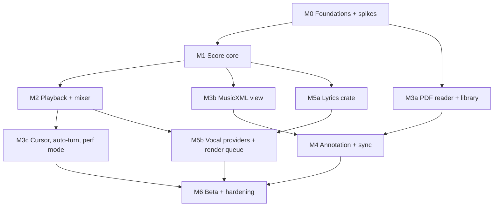

# Cantor: Implementation Plan

Derived from `MusicXML Score Reader - PRD & Test-Driven Development Plan.md` (2026-11-21).
This turns the PRD milestones into ordered, test-first work packages with explicit
dependencies, test names and exit gates. Requirement IDs (LIB-01, PLAY-02, ...) are the
PRD's; work package IDs (WP-x.y) are new.

## 0. Guiding decisions

| Topic | Decision | Reason |
| --- | --- | --- |
| Core language | Rust workspace, edition 2021, MSRV pinned in `rust-toolchain.toml` | PRD section 6 |
| Single source of time | `timeline::Timemap` (unfolded, tempo-resolved) is consumed by audio, cursor, lyrics, vocal | PRD: "the unfolded timemap is the one source of time" |
| Internal time units | Musical time = rational `divisions` ticks normalised to a fixed PPQ (960 per quarter). Real time = `u64` sample frames at the engine rate, seconds only at the edges | Avoids float drift (< 5 ms after 10 min target) |
| Determinism | Every engine (synth, mixer, scheduler) supports offline render to a buffer | Enables audio tests (~8% of suite) without devices |
| Test naming | `<reqid>_<behaviour>`, e.g. `play_02_dal_segno_al_coda_unfolds_in_order` | PRD TDD rule 2 |
| Snapshots | `insta` with JSON (`*.timemap.json`, `*.events.json`, `*.lyrics.json`) | PRD fixtures section |
| Oracle | Verovio CLI/Python run in `tools/oracle` produces expected outputs once, checked in; CI never needs Verovio to run unit tests | Keeps core CI hermetic |
| Errors | `thiserror` per crate, no panics on bad input; fuzz the parser (`cargo fuzz`) | LIB-01 "never a crash" |

## 1. Dependency graph



Critical path: M0 -> M1 (parser, unfolding, timemap) -> M2 (scheduler, mixer) -> M3c -> M6.
M3a (PDF, library, forScore import) and M5a (lyrics) are off the critical path and can run in parallel
with a second developer from week 3 to 5.

## 2. Crate responsibilities and public API sketch

```
crates/score     Score, Part, Staff, Voice, Measure, Event{Note,Rest,Chord}, Pitch, Lyric,
                 Direction{Tempo,Dynamic,Segno,Coda,Fine,DaCapo,...}, Barline{Repeat,Ending}
                 parse_musicxml(&[u8]) -> Result<Score>, parse_mxl(&[u8]) -> Result<Score>
                 transpose(&Score, semitones) -> Score
crates/timeline  unfold(&Score) -> Vec<MeasureVisit>; TempoMap; Timemap { events: Vec<TimedEvent> }
                 TimedEvent { part, staff, voice, measure_visit, tick_on, tick_off, sec_on, sec_off, pitch, velocity }
crates/audio     Channel{gain_db,pan,mute,solo}; Mixer; resolve_audibility(&[Channel]) -> Vec<bool>;
                 Preset{MyPart,WithoutMe,Balanced,Custom}; Scheduler (sample clock); Synth trait
                 (rustysynth impl); render_offline(&Timemap, &Mixer, sr) -> Vec<f32>; Loop{a,b}; Metronome
crates/lyrics    extract(&Score, part, verse) -> Vec<Phrase>; Phrase{syllables: Vec<Syllable{text, notes, syllabic}>}
crates/vocal     trait VocalProvider { estimate, render(phrase), voices }; adapters; RenderCache (content hash)
crates/library   SQLite schema, metadata, search (FTS5), setlists, backup/restore, forScore import (.4SC/.4SS/.4SB)
app/             Tauri 2 + Svelte; Verovio WASM view; PDF.js / PDFKit plugin; keyring plugin
```

## 3. Milestones as work packages

Each WP lists: tests written first (red), then the build, then done criteria.

### M0 Foundations + spikes (weeks 0 to 3)

| WP | Tests first | Build | Done |
| --- | --- | --- | --- |
| WP-0.1 Workspace | `cargo test` on empty workspace; smoke test per crate | Cargo workspace with 6 crates, `rust-toolchain.toml`, `clippy`/`fmt` config | `cargo test --workspace` green locally |
| WP-0.2 CI | CI job fails if any test fails, if fmt/clippy fail, or coverage < threshold | GitHub Actions: Linux, macOS, Windows core; iOS sim + Android emulator jobs stubbed until app exists | All 5 target jobs exist; core jobs green |
| WP-0.3 Corpus | `fixtures_manifest_lists_existing_files` (every manifest entry exists, has expected outputs) | Collect 40 files: MusicXML unofficial test suite subset (repeats, voltas, tuplets, lyrics, transposing), 10 CPDL SATB, 1 stress score. `fixtures/manifest.toml` with licence per file | 40 files + licences recorded |
| WP-0.4 Oracle | Oracle script is deterministic (run twice, identical output) | `tools/oracle`: Verovio (Python bindings) -> `*.timemap.json`, `*.events.json` (from Verovio MIDI) normalised to our schema | Expected outputs checked in |
| WP-0.5 First red test | `lib_01_parses_hello_world_musicxml` | Minimal parser for that file | Green |
| S1 Verovio WASM in Tauri on iPad | Measure first-page time on a 20-page score | Throwaway Tauri iOS app | Report: first page time, memory, LGPL plan |
| S2 Singing quality | Pitch/onset metric script (pYIN) on 3 English + 3 Swedish pieces | Scripts in `tools/spikes/s2` | **Engine chosen by ear (2026-11-22, `docs/spikes/singing-engines.md`): SoulX-Singer, 16 steps, no CFG (RTF 2.5 on M2 GPU).** Sung lyrics are English only (decision 2026-11-22) |
| S3 ElevenLabs STS on sung guide | Same metric before and after STS | Script | Report: cents error delta; keep or drop hybrid |
| S4 Pencil ink latency in WebView | High-speed video or `PointerEvent` timestamps vs display | Throwaway app | Report answers Q6 (native overlay needed?) |
| S5 forScore formats | Parse each example file without unknown-byte loss (round-trip of container) | Format notes `docs/formats/forscore.md`, prototype parser in `crates/library` | Documented structure of .4SC/.4SS/.4SB |

Blocking inputs from product owner: forScore example files (S5), decisions Q3, Q5, Q6.

### M1 Score core (weeks 3 to 7)

| WP | Tests first | Build | Done |
| --- | --- | --- | --- |
| WP-1.1 Partwise parser | `lib_01_parses_hello_world_musicxml`, `lib_01_parses_every_corpus_file`, `lib_01_invalid_xml_returns_error_not_panic`, fuzz target `parse_musicxml` | quick-xml streaming parser for `score-partwise`: part-list, attributes (divisions, key, time, clef, transpose, staves), note (pitch, unpitched, rest, duration, voice, staff, chord, grace, tie, time-modification, lyric), backup/forward, direction, sound, barline | >= 98% corpus parses |
| WP-1.2 Timewise + MXL | `lib_01_parses_mxl_container`, `lib_01_timewise_equals_partwise_model` | zip + `META-INF/container.xml` rootfile lookup; timewise -> partwise conversion | Green |
| WP-1.3 Model normalisation | `score_divisions_normalised_to_960_ppq` (proptest: any divisions value), `score_backup_forward_assign_voice_offsets` | Normalise ticks, resolve chords, voices per staff (needed for PLAY-05) | Green |
| WP-1.4 Transpose | `view_05_transpose_roundtrip_property` (proptest, n in -24..24), `view_05_transposing_instrument_concert_pitch` | Pitch spelling via line-of-fifths, key signature transpose, `<transpose>` handling | Green |
| WP-1.5 Unfolding | `play_02_simple_repeat`, `play_02_voltas_1_2`, `play_02_da_capo_al_fine`, `play_02_dal_segno_al_coda_unfolds_in_order`, `play_02_nested_and_times_attribute`, property: unfolded duration = sum of visited measure durations | Repeat stack state machine, endings by `number` list, jump directions from `<sound dacapo/dalsegno/tocoda/fine>` and words fallback | 100% navigation fixtures match oracle |
| WP-1.6 Tempo map + timemap | `play_01_timemap_matches_oracle` per fixture (insta), `play_02_tempo_change_mid_measure`, `play_02_meter_change`, `play_02_tuplets_exact_ticks`, `play_02_ties_merge_notes`, `play_02_grace_notes_steal_time`, drift test: 10 min at 7/8 + tempo changes accumulates < 1 sample error | `TempoMap` (tick -> seconds, piecewise), `Timemap` builder, tie merging, grace policy | Gate M1 |

Gate M1: >= 98% corpus parses; timemaps equal oracle on 100% of navigation fixtures; >= 85% line coverage (cargo-llvm-cov) on `score` and `timeline`.

### M2 Playback + mixer (weeks 7 to 11)

| WP | Tests first | Build | Done |
| --- | --- | --- | --- |
| WP-2.1 Event list | `play_01_events_equal_reference_midi` (pitch, onset, duration per fixture) | Timemap -> `MidiEvent` stream per channel | Green on corpus |
| WP-2.2 Channels | `play_05_two_voices_one_staff_are_two_channels`, `play_09_midi_program_respected`, `play_09_soprano_falls_back_to_choir_aahs` | Channel graph keyed by (part, staff, voice); GM program mapping + name heuristics table | Green |
| WP-2.3 Mute/solo/gain | `play_03_solo_mute_truth_table` (table-driven, all 2^n for n<=4 + proptest), `play_03_gain_range_minus_inf_to_plus6`, `play_04_my_part_sets_exact_gains`, `play_04_without_me_mutes_selected`, `play_04_balanced`, `play_04_custom_preset_persists` | Pure mixer maths in `audio::mix`, presets serialisable (serde) | Green |
| WP-2.4 Synth + offline render | `audio_offline_render_is_deterministic`, `play_03_solo_correlation_gt_099` (property), `audio_no_clipping_at_64_parts` | `Synth` trait, rustysynth impl with MuseScore General SF2 (downloaded in CI, not committed if size is an issue), limiter | Green |
| WP-2.5 Scheduler | `play_06_tempo_change_applies_next_beat`, `play_07_loop_wraps_within_one_buffer`, `play_06_count_in_bars`, `perf_03_metronome_jitter_lt_1ms` (offline) | Sample-clock scheduler, lookahead queue, tempo scaling via timemap re-resolution, A-B loop by measure-visit range | Green |
| WP-2.6 Realtime output | Device test: buffer size <= 10 ms on Mac (`cpal`), xrun counter = 0 over 60 s at 64 parts | cpal backend, lock-free command queue (rtrb) from UI to audio thread, position feedback ring for cursor (NFR-02) | NFR-01 met on Mac; iPad measured in M3 |

Gate M2: all PLAY P0 green; NFR-01 latency met on iPad and Mac.

### M3 Reader UI (weeks 9 to 16)

Split in three tracks.

**M3a Library + PDF (from week 9, independent of playback)**

| WP | Tests first | Build |
| --- | --- | --- |
| WP-3.1 Library DB | `lib_03_metadata_survives_restart`, `lib_03_export_import_roundtrip`, `lib_04_search_10k_lt_100ms` (bench), `data_03_restore_identical_hash` | SQLite (rusqlite) schema + migrations, FTS5 over metadata and part names |
| WP-3.2 PDF import/view | `lib_02_500_page_import_lt_3s`, thumbnails lazy (Playwright) | PDF.js in web/desktop, PDFKit plugin on Apple |
| WP-3.3 forScore import | `lib_07_every_example_imports`, `lib_07_annotation_positions_within_2pt`, `lib_07_unknown_fields_preserved`, `lib_08_setlist_order_and_placeholders`, `lib_08_backup_score_count` | Parsers from S5 |
| WP-3.4 Setlists | `set_01_reorder`, `set_01_placeholder_in_performance_mode` | Setlist model + UI |

**M3o OMR: notes from PDFs (promoted from v2, decision 2026-11-21)**

forScore files and PDFs carry no note data, so playback, mixer and sung parts
for a forScore library need optical music recognition. LIB-06 moves from P2 to
P0 for v1. Pipeline: PDF -> Audiveris -> MusicXML -> timemap -> MIDI/audio.
The user corrects recognition errors later (WP-3.13).

| WP | Tests first | Build |
| --- | --- | --- |
| WP-3.11 Pipeline | `lib_06_pdf_to_musicxml_and_midi`, `lib_06_4sc_embedded_pdf_is_recognised`, `lib_06_engine_failure_is_reported_not_panicked` | `crates/omr`: `OmrEngine` trait, Audiveris CLI adapter, `cantor-omr` tool (done) |
| WP-3.12 Scan cleanup | `lib_06_retries_with_cleaned_scan_when_raw_pdf_fails`, `lib_06_empty_result_triggers_cleanup` | 300 DPI render, crop, deblur, threshold, despeckle (Python today in `tools/omr`, port to Rust) |
| WP-3.13 Correction UI | `lib_06_user_edit_survives_reopen`, `lib_06_low_confidence_measures_flagged` | Measure-level review: overlay recognised notes on the PDF, flag measures whose length does not match the time signature, edit pitch/duration |
| WP-3.14 Where OMR runs | `lib_06_remote_engine_contract` (mock server) | Desktop: Audiveris sidecar (85 MB download, ships its own Java runtime). iPad/phone: remote OMR server the user runs (same model as HF voice), or OMR on the desktop app and sync |
| WP-3.15 Measure map | `lib_05_cursor_on_pdf_from_omr_measure_map` | Keep Audiveris staff/measure boxes (`.omr` book) so the play cursor and auto-turn work on the original PDF (LIB-05) |

Measured on the product owner's 12 scanned choral scores (spike S6):

| Result | Scores |
| --- | --- |
| Recognised from the raw PDF | 9 of 12 |
| Recognised after scan cleanup (WP-3.12) | +1 (kunglilje: 665 notes) |
| Recognised page by page (book crashed on a page without music) | +2: Glimmande Nymf (page 3 is verse text), I bröllopsgården (page 1 is a blank/cover scan) |
| Still failing | Supa klockan öfver tolf (old engraving with faint staff lines, 6 notes found, reported as failed instead of a near-empty MIDI) |
| Same notes and onsets as MuseScore's playback of the same MusicXML | Olaf Trygvason 100%, Stad i ljus 100%, Jag och min far 98%, Bacchi 95%, Calypso 92%, Är jag född 91% |
| Island | 99% after repeat unfolding (was 19%) |
| Glimmande Nymf | 100% |
| I bröllopsgården | 36%: the scan has many meter changes (7/8, 5/4, 15/16) that OMR misses, so measure lengths differ from MuseScore's reading; needs the correction UI (WP-3.13) |
| Do you hear what I hear (TTBB, added 2026-11-22) | 18 PDF pages that are iPad screenshots of two-page publisher "PREVIEW" spreads at about 100 DPI, each spread captured twice. Raw: only 2 pages read (40 tenor notes). With `tools/omr/split_spreads.py` (crop screen border, split at the gutter, upscale, background division removes the grey watermark, drop duplicate pages): 141 measures, 4 voices with 240-259 notes each, piano 1797 notes, 332 s. Pitch accuracy not checked against a reference. Lyrics OCR is poor at this resolution: words run together ("doyouseewhat"), about 20 unknown words per voice, sung on "la". Not yet wired into the automatic fallback ladder |

OCR for lyrics and text: Audiveris needs Tesseract `tessdata` (full, not
`tessdata_fast`, it uses the legacy engine). With `swe+eng`, Å/Ä/Ö are read
correctly ("Är jag född"); with English only they become A/a/o.

Full run with `swe+eng` OCR (2026-11-22): 11 of 12 convert, 9 MusicXML files
carry lyrics (30 to 684 syllables each; the two joined page-by-page files have
none yet because the writer does not model lyrics). Against MuseScore: Calypso,
Olaf, Stad i ljus, Är jag född, Glimmande Nymf 100%, Island 99.8%, Bacchi 97%.
Side effects of OCR to handle:
- Misread text becomes chord symbols (`<harmony>`, 37 in "Jag och min far");
  MuseScore plays them, Cantor rightly does not. Strip or ignore them on import.
- Part names become OCR noise (". '1'", "Tent or"): name parts from staff
  position/clef (S/A/T/B) and let the user rename.
- Text recognition changes how Audiveris splits systems into parts (kunglilje
  2 -> 4 parts); the per-part mixer needs a "merge parts" action.

That measures **our MIDI generation** against an independent player. It does
not measure **OMR accuracy** against the printed page; that needs hand-checked
ground truth for a few pieces (WP-3.13 fixtures).

**M3b MusicXML view (after M1)**

| WP | Tests first | Build |
| --- | --- | --- |
| WP-3.5 Engraving | `view_01_golden_png_matches` (pixelmatch tolerance), `view_03_phone_width_ge_2_measures_per_system` | Verovio WASM worker, SVG per page, off UI thread (NFR-03) |
| WP-3.6 Page modes | `view_02_each_mode_one_tap`, `view_02_position_kept_on_rotation` | Single, two-up, half-page, scroll |
| WP-3.7 Part visibility/themes | `view_04_hidden_part_still_plays`, `view_06_contrast_ge_4_5` | Verovio part filter, CSS themes |

**M3c Performance (after M2)**

| WP | Tests first | Build |
| --- | --- | --- |
| WP-3.8 Cursor + auto-turn | `play_08_cursor_highlights_sounding_note`, `play_08_turns_before_last_system_ends` | Verovio `getElementsAtTime`, cursor driven by audio clock ring |
| WP-3.9 Perf mode + pedals | `perf_01_no_annotation_in_performance_mode`, `perf_02_pedal_maps_to_action` (HID simulation) | Lock overlay, key mapping settings |
| WP-3.10 E2E flow | Playwright: import -> open -> turn page -> play -> solo alto | Wiring |

Gate M3: LIB, VIEW, SET, PERF P0 green; 20-page PDF opens in < 1 s on iPad.

### M4 Annotation + sync (weeks 16 to 20)

| WP | Tests first | Build |
| --- | --- | --- |
| WP-4.1 Ink model | `ann_01_undo_100_steps`, `ann_02_layer_visibility_persists`, `ann_03_stamps_scale_with_zoom` | Stroke model (Automerge doc per score), layers, stamps, text |
| WP-4.2 Anchoring | `ann_04_annotation_stays_on_measure_after_reflow` (fixture at 3 widths) | Anchor = (measure id, staff, offset in measure-normalised coords) |
| WP-4.3 Ink latency | Device test `ann_01_ink_latency_lt_20ms` | WebView canvas or native overlay per S4 |
| WP-4.4 Sync + backup | `data_02_two_devices_converge` (CRDT merge property), `data_03_restore_identical_hash`, `data_01_p0_offline` | Folder sync of Automerge changes + SQLite export; backup bundle |
| WP-4.5 Annotated PDF export | `ann_05_annotations_in_exported_pdf` (parse output with lopdf) | PDF writer |

### M5 Sung lyrics (weeks 16 to 25)

**M5a Lyrics (can start after WP-1.6, week 7, with a spare developer)**

| WP | Tests first | Build |
| --- | --- | --- |
| WP-5.1 Extractor | `vox_01_lyric_fixtures_expected_phrases` (insta), property: no syllable on a rest, every `begin` closed by `end`, melisma spans notes until next syllable/extender end | `crates/lyrics` |
| WP-5.2 Timing resolver | `vox_tempo_and_transpose_applied_from_timemap` | Phrase splitting at rests >= 1 beat or breath marks, seconds from timemap |

**M5b Vocal**

| WP | Tests first | Build |
| --- | --- | --- |
| WP-5.3 Provider trait + mock | `vox_03_rendered_track_becomes_mixer_channel`, `vox_06_estimate_requires_confirmation`, `nfr_12_cap_10_minutes` | `VocalProvider` trait, render queue, `MockProvider` |
| WP-5.4 Cache | `vox_07_reopen_uses_cache_no_api_call`, `vox_08_mute_does_not_rerender`, `vox_08_tempo_rerenders_affected_phrases` | Content hash of (phrase, tempo, transpose, voice, provider), files on disk |
| WP-5.5 Keys | `vox_02_key_never_in_logs` (log capture), `vox_02_key_deletable`, `vox_02_validated_with_test_call` (mock) | Keyring plugin, redacting `Secret<String>` type |
| WP-5.6 Adapters | **SoulX-Singer first** (serialiser done in `cantor-vocal::soulx`; runner: Core ML conversion on Mac/iPad, server for phones). DiffSinger (ONNX, with variance model) as fallback if a re-test sounds acceptable; ElevenLabs Music optional. Contract tests per adapter | Core ML / PyTorch runner, HTTP adapters (reqwest) for server engines |
| WP-5.6b Voices | `vox_09_prompt_voice_licence_shown`, `vox_09_consent_required_for_reference_clip` | Ship 3 to 5 prepared SoulX voice prompts recorded under our own licence (S, A, T, B); Core ML conversion at fp16, int8 test for phones |
| WP-5.7 Accuracy nightly | `vox_04_median_pitch_error_lt_50_cents`, onset within one sixteenth | pYIN/CREPE script against live endpoints |
| WP-5.8 Voice choice | `vox_09_consent_required_for_reference_clip`, clip sent only to chosen provider | Settings UI |

### M6 Beta + hardening (weeks 25 to 30)

Accessibility tests (axe in Playwright, VoiceOver labels), `nfr_10_sv_en_localisation_complete`,
2-hour soak `nfr_02_no_drift_gt_5ms`, licence page from `fixtures`/asset manifest (NFR-09),
TestFlight, Play beta, Windows installer.

### P1, P2 and NFRs not covered by a WP above

| Req | Slot | Test first |
| --- | --- | --- |
| LIB-05 (P1) Link PDF + MusicXML | M3c, after WP-3.8 | `lib_05_cursor_on_pdf_with_manual_measure_map` |
| LIB-06 OMR via Audiveris | **P0 for v1** (was P2), see M3o | `lib_06_*` (8 tests) |
| LIB-09 (P2) Export .4SC/.4SS | v2, reuses S5 parser | `lib_09_roundtrip_keeps_annotations` |
| PLAY-10 (P1) Dynamics/articulations | M2, with WP-2.1 | `play_10_pp_lt_mf_lt_ff_velocity`, `play_10_staccato_halves_length` |
| PLAY-11 (P1) Export WAV/M4A | M2, after WP-2.4 (reuses offline render) | `play_11_export_length_within_10ms` |
| PLAY-12 (P1) Background audio, media keys | M3c | Device tests on iOS/Android (lock screen) |
| VOX-05 (P1) ElevenLabs performance mode | M5b, WP-5.6 | `vox_05_labelled_not_score_accurate`, `vox_05_aligned_by_word_timestamps` |
| SET-02 (P1) Setlist bundle | M4, with WP-4.4 | `set_02_bundle_identical_content_hash` |
| PERF-04 (P1) Backing tracks + turn markers | M3c | `perf_04_turn_markers_within_50ms` |
| NFR-04 Memory <= 400 MB | M6 | Device memory probe with 50 MB SF2 + 100-page score |
| NFR-05 Offline | Same as DATA-01 (WP-4.4) | `data_01_p0_offline` |
| NFR-06 Secrets | WP-5.5 | `vox_02_key_never_in_logs`, plus `nfr_06_backup_contains_no_keys` |
| NFR-07 Privacy | M6 | `nfr_07_no_network_without_opt_in` (network capture in E2E) |
| NFR-08 Accessibility | M6 (axe), labels checked from M3 | `nfr_08_all_controls_labelled` |

## 4. Staffing and calendar (2 to 3 developers)

| Weeks | Dev A (core) | Dev B (app) | Dev C (optional, voice) |
| --- | --- | --- | --- |
| 0 to 3 | WP-0.1 to 0.5 | S1, S4 | S2, S3, S5 |
| 3 to 7 | M1 | WP-3.1, 3.3 (forScore import) | WP-5.1 (lyrics) after WP-1.3 |
| 7 to 11 | M2 | WP-3.2, 3.4, 3.5 | WP-5.2, 5.3 |
| 11 to 16 | WP-2.6 iPad, help M3c | M3b, M3c | WP-5.4, 5.5 |
| 16 to 20 | M4 sync/backup core | M4 ink UI | WP-5.6 |
| 20 to 25 | Perf + bugs | Polish | WP-5.7, 5.8 |
| 25 to 30 | M6 | M6 | M6 |

## 5. Traceability

`docs/traceability.md` (generated) maps each requirement ID to its tests. A CI script
(`tools/trace.sh`) greps test names for `<reqid>_` and fails if any P0 requirement has zero
tests (NFR-11: 100% of P0 criteria automated).

## 6. Risks that change the plan

| Trigger | Plan change |
| --- | --- |
| S1: Verovio WASM first page > 1.5 s on iPad | Pre-engrave pages in a worker on import and cache SVG; fallback OSMD |
| S4: WebView ink > 20 ms | Native PencilKit overlay plugin (Q6) |
| S2: Swedish unusable | **Decided 2026-11-22: sung lyrics are English only** for v1; the app shows `cantor_vocal::SUNG_LYRICS_NOTICE` wherever singing is offered and plays non-English parts with instruments. Swedish UI and Swedish lyric display/OCR still ship |
| SoulX-Singer has no Swedish phonemes | Out of scope for v1 (see above). Revisit only if a Swedish-capable engine appears or fine-tuning is funded |
| SoulX is 704 M params (2.8 GB fp32) | Core ML fp16 (~1.4 GB) on M-series iPad/Mac; int8 or server/sync for phones; default 16 steps without CFG measured at RTF 2.5 on M2 |
| S5: forScore format encrypted/opaque | Import embedded PDF + metadata only, warn about annotations |
| OMR quality too low on real choir scans | Ship correction UI (WP-3.13) before playback for PDFs; try a second engine (oemer, or a cloud OMR) behind `OmrEngine`; ask users for born-digital PDFs or MusicXML from the publisher |
| Audiveris (AGPL-3.0) licence | Run as a separate process/server, never linked; legal review in M0 alongside Verovio |
| No Java on iPad | OMR on desktop or a user-run server; iPad gets the MusicXML by sync |
| Corpus < 98% after M1 | Add normalisation pass per exporter before M2 starts |

## 7. Started in this repo (M0)

- [x] Cargo workspace with the PRD crate layout
- [x] `lib_01_parses_hello_world_musicxml` red then green
- [x] CI on a self-hosted macOS arm64 runner (label `cantor`, repo github.com/hkhard/Cantor); Linux/Windows/iOS sim/Android jobs still to add (WP-0.2)
- [ ] Corpus collection + Verovio oracle (WP-0.3, WP-0.4)
- [ ] Spikes S1 to S4
- [x] S5 forScore formats: `.4sc` and `.4ss` documented in `docs/formats/forscore.md`; importer in `crates/library/src/forscore.rs` (LIB-07/LIB-08 tests green on synthetic and real samples). Open: annotations, attachments, placeholders, `.4sb` (need more samples)
- [ ] Decisions Q3, Q5, Q6 from the product owner
- [x] S6 OMR: `cantor-omr` turns PDF/.4sc/.4ss into MusicXML + MIDI (Audiveris + scan cleanup); 10 of 12 sample scores converted
- [x] MXL container, ties, tempo, measure lengths, MIDI programs in `cantor-score`; timemap and SMF writer in `cantor-timeline`
- [x] Repeat/volta/D.C./D.S./Coda/Fine unfolding (WP-1.5, 15 PLAY-02 tests), MusicXML writer, page-by-page OMR fallback, Swedish OCR for lyrics: 11 of 12 sample scores produce MIDI (Supa klockan still fails)
- [x] Lyrics (VOX-01): `<lyric>` verse/syllabic/extend in the model and writer; `cantor-lyrics::extract` gives timed phrases per part/voice/verse (melismas, ties, repeats sing the next verse); runs on the OCR'd sample scores
- [x] SoulX-Singer spike (`docs/spikes/soulx-singer.md`): fits English score mode; no Swedish; CUDA server. `cantor-vocal::soulx` serialises phrases to its target metadata (contract tests)
- [x] Engine choice (`docs/spikes/singing-engines.md`): SoulX-Singer by ear; measured RTF 1.1 on M2 at 8 steps without CFG (13 cents); DiffSinger kept as fallback; NNSVS dropped
- [x] Render defaults by ear: 16 steps, no CFG (`cantor_vocal::soulx::RenderSettings`); sung lyrics English only with in-app notice (`cantor_vocal::SUNG_LYRICS_NOTICE`)
- [x] English phonemizer (VOX-04): bundled CMUdict, elisions, compounds, OCR typo repair (rn/m, n/ri, r/i, ... used only when exactly one word fits); unknown words are sung on "la" and listed, not fatal
- [x] Lyric extraction for OCR'd through-composed songs: `extract_merged` takes any lyric line where line 1 is missing; role cues ("Female:", "Children:") are not sung; a held syllable ends at a phrase break
- [x] First full part sung end to end (2026-11-22): Christmas Day, voice part, 114 s, `sing_prepare` -> `tools/soulx/render.py` (SoulX, 16 steps, no CFG, English example prompt, MPS). `tools/soulx/pitch_check.py`: 249 notes, 99% voiced, median error 19 cents, 80% within 50 cents (VOX-04 target < 50 cents median: met), 3% octave errors, mean offset -3 cents. `auto_shift` is now off: the part sounds at written pitch. Mixed with the MIDI (GeneralUser GS soundfont) for listening. Not verified: diction and how it sounds (needs your ears); lyric correctness is limited by OCR (some lines repeat words such as "Christ Christ"). Speed: RTF 4.9 plus 3 min model load, because the machine was swapping (9 GB swap used); the earlier clean benchmark was RTF 2.5
- [ ] Singing parked (2026-11-22, product owner: "barely passable"). Kept: lyrics extraction, English G2P, SoulX tools. Later: Core ML conversion spike, VocalProvider trait + render cache (VOX-06/07), own voice prompts per S/A/T/B (WP-5.6b)
- [x] Voice instruments (PLAY-05/09, `cantor_timeline::channels`): one mixer channel per sung line; voices sharing a staff split, stray OMR voices (< 40% of the busiest voice or < 4 notes) merged into the nearest line; role from part name (incl. Swedish and OCR noise like "TenorZ", "Bas 1"), else from the score title ("TTBB", "Manskör", "SSA", "SATB"), else from the pitch range of the whole choir. Distinct timbre per line, different instrument families for neighbours: S Flute/Oboe, A Clarinet/Alto Sax, T Trumpet/French Horn, B Cello/Bassoon, more divisi lines get further related instruments; every channel's program is unique. Lines panned -0.4..+0.4, top voice left. Checked on all 12 samples: SATB, TTBB and divisi scores come out right; "Jag och min far" has 7 lines (OCR part names) and "kunglilje" 9 lines (two systems read as separate parts), not fixed
- [x] Playback engine (M2 core, `cantor-audio`): `Engine<S: Synth>` plays the timemap with notes on their exact sample frame for any buffer size, rustysynth + GeneralUser GS (bundled, licence allows redistribution); mixer with -inf..+6 dB, pan, mute/solo (mute wins, several solos add), presets My part (others -12 dB) / Without me / Balanced (PLAY-03/04), seek with all-notes-off, tempo 25-200% without pitch change (PLAY-06). Renders 220-270x realtime on the Mac. 10 tests (8 with a recording fake synth, 1 rendering real audio). Not yet: count-in, metronome, A-B loop, dynamics
- [x] Demo iPad app (`app/`, Tauri 2 + Svelte 5 + Verovio 6 WASM): library of the converted sample scores, engraved score (Verovio) with the playing measure highlighted and automatic page turn, tap a measure to play from there, side tap zones / arrow keys to turn pages, transport (play/pause, to start, scrub, tempo, follow toggle), mixer per channel with role colours and instrument names, My part / Without me / Balance, choir type override (Auto/Blandad/Manskör/Damkör). Audio in Rust (cpal), AVAudioSession Playback so it sounds with the silent switch on, background audio mode. iPad-only target, team 33ZQ6Q226L, bundle id `se.nikielhard.cantor`. `tools/ipad.sh sim|device`. Verified on the iPad Pro 13" simulator by screenshot: library, Olaf Trygvason playing with the cursor on the right measure at 0:20, TTBB detected as Manskör. Signed device IPA built (provisioning includes Tinas iPad). Not verified: sound on a real iPad (the iPad was offline), audio latency, Apple Pencil, performance with large scores on the iPad mini. Known gaps: the scores are OMR output, so wrong notes/lyrics from OCR are visible; no PDF view yet; no file import yet (scores are bundled)
- [x] Original PDF view (LIB-05, 2026-11-22, after product owner feedback that the redrawn OMR notation showed misread notes and text as if they were the score): the app shows the original PDF page (pdf.js) and draws the playing measure as a box from the Audiveris measure map (`cantor_omr::measure_map`: `<stack left right>` per `<system>`, y-range from barline bounds, courtesy stacks skipped, split by movement, page-by-page and cleaned fallbacks). Tap a measure on the page to play from there; Original/Notbild toggle. Map equals the MusicXML measure count on 10 of 13 scores (Bacchi, Christmas Day, Calypso, Glimmande Nymf, Island, Jag och min far, Olaf, Stad i ljus, kunglilje, Är jag född); no box for Do you hear (screenshot spreads), I bröllopsgården (page books split into movements), Supa klockan (not converted): those show the PDF without a cursor and say so. OCR text filter (LIB-06): dynamics, URLs, credits, specks and verse numbers are not lyrics, OCR chord symbols removed, in both singing and the notation view; files from notation programs untouched. Clean MusicXML (MuseScore "Que? Status Quo medley", TTT/TTBB) plays with 6 lines: parts named "T1 T2 B1 B2" with the MuseScore default Piano instrument are now treated as voices, the lead part is labelled "(solo)". Verified in the iPad simulator by screenshot (Olaf PDF page with box on the right bar at 0:16, medley notation with 6 channels); installed and launched on the iPad mini. Not verified on the device: sound, PDF rendering speed
- [x] Playback features (2026-11-22): PLAY-06 metronome click (GM wood blocks, accent on one, compound meters counted in dotted beats) and one-bar count-in at the current tempo; PLAY-07 A-B loop over written bars, wrapping on the exact sample frame with notes released; PLAY-10 dynamics to velocity per staff (marks and `<sound dynamics>`), staccato 50% / staccatissimo 25% length, accents louder; swing (`<sound><swing>` ratio kept, bare "Swing" = triplet 2:1, "Straight" ends it, 16th swing). App: Slinga (tap first and last bar), Klick, Inräkning. 150 tests
- [x] Share sheet / Open in (LIB-01/02/07): the iOS app declares MusicXML (`com.recordare.musicxml`, `com.recordare.musicxml.uncompressed`), forScore (`com.forScore.4sc`, `com.forScore.4ss`, identifiers from forScore's developer page) and PDF as viewer document types, so Cantor appears in "Open in…"/share for these files from Files, Mail, AirDrop, forScore and others. Received files land in Documents/Inbox; Cantor imports them into the user library (Documents, also visible in the Files app as "On My iPad > Cantor"; .4sc/.4ss unpacked to their PDFs; names made safe, never overwritten; originals moved to Documents/.imported) and opens a single shared score directly. Importera button uses the system file picker. PDF-only scores (forScore files) are readable without sound. Verified in the iPad mini simulator by handing the app file URLs the way iOS does (`simctl openurl`): a .4sc opened as its PDF page, an .mxl opened ready to play. Not verified: the real share sheet from another app on the device (needs your hands), large .4ss setlists
- [x] Feature pass towards the full PRD (2026-11-22). Core crates, tested:
  - `cantor-library::store` (LIB-03 metadata, LIB-04 search over 10,000 items under 100 ms in release, SET-01 setlists with placeholders, PLAY-04 custom presets, per-score settings, LIB-08 setlist from a forScore .4ss; JSON store with atomic save and a backup on corrupt files).
  - `cantor-library::bundle` (SET-02 `.cantorset`: scores, annotations, metadata and mixes, sha256 content hash identical after a round trip, tampered files rejected).
  - `forscore::write_4sc/write_4ss` (LIB-09). These round-trip through our own parser only. Whether forScore opens them is not verified.
  - `cantor-score` transpose (VIEW-05: key respelled, fewer accidentals).
  - `cantor-annotations` (ANN-01..05: page and measure anchors, ink, highlighter, text, stamps, shapes, raster layers, layers, undo 200, eraser, SVG, annotated PDF via lopdf).
  - `cantor-audio` pitch pipe (PERF-03: starting note per part or all, also while paused).
  - 194 tests in total.
- [x] App wiring, same day:
  - **Library:** search, a metadata editor ("Info"), setlist tabs (create, add, reorder, remove, delete, "Spela listan", ◀ ▶ between pieces in the reader, missing scores shown as placeholders) and About with licences and a language switch.
  - **Reader ("•••" menu):** Framförande, choir type, transpose ±12 (sound and notation), parts shown in the notation (VIEW-04, sound unaffected), page modes (VIEW-02: single, two pages in landscape, half-page turn, continuous scroll) and Pedal.
  - **Remembered per score:** mixer, my part, tempo, view, choir, transposition, hidden parts and saved mixes.
  - **Annotations on the original page:** pen with Pencil pressure, highlighter, eraser, text, 13 stamps, colours, layers with show/hide, and undo/redo. Saved per score in Documents/Annotations.
  - **Pitch pipe:** "♪ Tonen" plays all parts as a chord, and ♪ on each mixer strip plays that part.
  - **Lock screen, Control Centre and AirPods (PLAY-12):** play, pause, toggle, and the title and position on the lock screen (MediaPlayer framework).
  - **Share:** "Exportera" adds a PDF with annotations and a forScore .4sc. Setlists share as a Cantor bundle or a forScore .4ss. `.cantorset` is registered as Cantor's own file type and is imported from the share sheet, Files or Importera.
  - **NFR-10:** the whole UI is in Swedish and English and follows the device language.
  - **NFR-08:** all new controls have labels. Not audited with VoiceOver.
  - `prompt()`/`confirm()` were replaced by in-app dialogs, because the iOS WebView may not show native ones.
- Fixes found while testing:
  - Scanned PDFs (JBIG2 images) showed blank pages because pdf.js could not load its wasm decoders. They are now served and bundled.
  - Notation for parts without a clef (some converted files) sat on ledger lines. A clef is now chosen from the part's range.
  - The highlighter in exported PDFs looked beaded. It is now drawn as one path.
- How it was verified:
  - `tools/ui_harness/run.sh` runs the real UI in WebKit at iPad mini size (744x1133) with the Rust backend mocked. 13 scenarios pass with no page errors: search, metadata, setlists, setlist navigation, pitch pipe, custom mix, four page modes, annotate (stroke, stamp, undo, layer hide), transpose, hide part, settings restored on reopen, performance mode and Swedish.
  - The backend commands were checked with the iOS build (simulator and device targets compile and link).
  - An annotated real PDF was rendered with macOS's PDF engine (Preview's): ink, highlighter, Swedish text and stamps are visible.
- Product owner tried the build on the iPad mini (2026-11-22): "all works as expected". That covers the features in normal use; the specific items below were not checked one by one.
- Not verified separately:
  - Apple Pencil feel and latency on the iPad.
  - Lock-screen controls and AirPods on a device.
  - The share sheets on a device.
  - forScore opening our .4sc/.4ss.
  - VoiceOver.
  - Two-up page mode in a real landscape rotation (only its layout logic was exercised).
  - Annotations are page-anchored in the UI. Measure anchors exist in the crate but are not used by the app yet (ANN-04 re-layout applies to notation, which has no ink UI).

## 8. Future features (parked)

- **Server-side OMR** (decision 2026-11-22: parked until the app earns money; containers cost). A plain Cloudflare Worker cannot run it (Audiveris needs Java, Tesseract and a few GB of RAM). Plan when revived: Worker as the front door, Cloudflare Containers (standard-2/3, linux/amd64 image with Audiveris, Tesseract swe+eng, the Python cleanup tools) behind it; app uploads PDF/.4sc, polls a job id, receives MusicXML plus the measure map (`<name>.measures.json`). Audiveris stays a separate AGPL process, as today. Rough estimate, not measured: about 1 cent per score on Containers pricing; cold start with a 1-2 GB image unmeasured. Until then OMR runs on a desktop (`cantor-omr`, `export_pdf_maps`) and scores come into the app as MusicXML + PDF.
- **Sung voices** (see section 7): parked.
